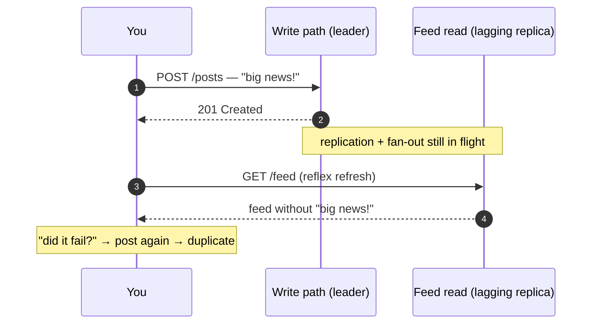
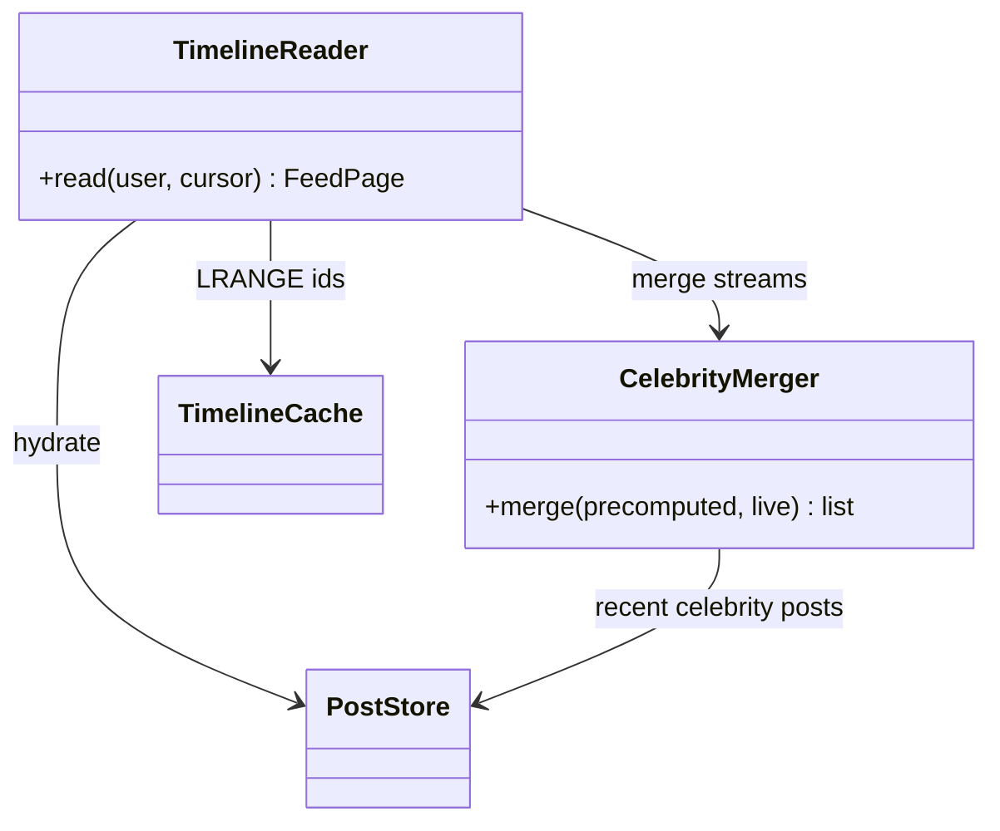
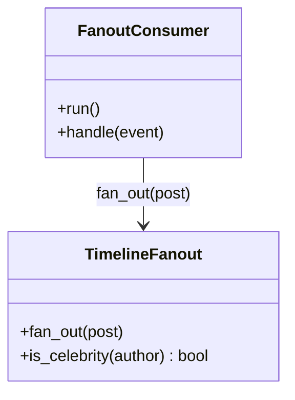

# 📰 Design a News Feed

> **Prerequisites:** [Nonfunctional Requirements](/synapse/system-design-from-first-principles/foundations/nonfunctional-requirements), [Data Models](/synapse/system-design-from-first-principles/data-foundations/data-models) | **You'll be able to:** run the delivery framework on the fan-out canonical; do the pull-vs-push arithmetic that decides the architecture, and defend the hybrid this lesson lands on — the same conclusion DDIA reaches independently; name the consistency guarantee behind *"why can't I see my own post?"* and three ways to provide it.

---

## 🧨 The problem (why this exists)

*"Design a news feed — Facebook's, say."* Users create posts and follow other users; opening the app shows recent posts from the people they follow, newest first; scrolling pages back through older ones. That's the entire product — and the third rep of [the delivery framework](/synapse/system-design-from-first-principles/foundations/the-interview-at-10000-feet) in this module, after the [URL shortener](/synapse/system-design-from-first-principles/case-studies/url-shortener) and [Ticketmaster](/synapse/system-design-from-first-principles/case-studies/ticketmaster). Where Ticketmaster was a contention problem and the shortener a read-scaling problem, this one is the canonical **fan-out** problem: one action by one user becomes work for millions.

It also holds a distinction no other case study here has: DDIA's second edition adopts this exact system — a social network with home timelines — as its running case study, with worked load numbers <abbr title="[ch. 2 pp. 33–36]">[i]</abbr>. Where other designs make you invent estimates, this one lets you check your arithmetic against the textbook. This lesson does, page cites and all.

**Functional requirements**:

1. Users can create posts.
2. Users can follow other users — a uni-directional follow, deliberately, rather than early Facebook's bidirectional friendship.
3. Users can view a feed of posts from the accounts they follow, in chronological order.
4. Users can page through that feed.

*Below the line:* likes and comments; private or restricted-visibility posts. Users are already authenticated.

**Non-functional requirements — quantified**:

1. Highly available, explicitly at consistency's expense — up to **1 minute of post staleness** is tolerated.
2. Posting and feed loads return in **< 500 ms**.
3. Scale to **2 billion users**.
4. **Unlimited follows, unlimited followers.**

Requirement 4 reads like generosity. It's a planted trap: *"unlimited followers"* is the interviewer reserving the right to ask what happens when an account with a hundred million followers posts — the celebrity problem, and this design's decisive deep dive. DDIA's version of the brief contributes one more number worth adopting out loud: a post should reach followers' feeds within about **five seconds** <abbr title="[ch. 2 p. 35]">[i]</abbr>. The staleness NFR and that freshness target are the yardsticks the delivery pipeline gets judged against.

---

## 💡 Intuition first

Start naive, and say you're doing it — name the coming scaling problems verbally while sketching the simple thing first, because a mostly-complete design you then deepen beats a perfect fragment.

Three tables: **users**, **posts**, **follows** — exactly the relational schema DDIA opens with (its Figure 2-1) <abbr title="[ch. 2 p. 34]">[i]</abbr>. The feed is then a query you run when someone asks: look up whom the reader follows, fetch those authors' recent posts, sort by timestamp descending, return the first page. In SQL it's one join across posts and follows, `ORDER BY timestamp DESC LIMIT` <abbr title="[ch. 2 pp. 34–35]">[i]</abbr>. Every functional requirement: satisfied. For a small product you'd be done.

Now run the textbook's numbers at it. Posts must appear within ~5 seconds, and without any push mechanism the client gets freshness the only way it can — **polling**, re-running the feed query every 5 seconds while the app is open. With 10 million users online, that's **2 million feed queries per second** <abbr title="[ch. 2 p. 35]">[i]</abbr>. Each query touches every followed account — 200 on average — so the storage layer eats **400 million per-sender lookups per second**, and worse for users following tens of thousands of accounts <abbr title="[ch. 2 p. 35]">[i]</abbr>. Four hundred million per second is not a *"add replicas"* number; no sane fleet answers it. And almost all of that work is *waste*: the overwhelming majority of polls find nothing new, yet each one recomputed the same join from scratch.

The instinct that saves the design: stop recomputing at read time — do the work **when the post is created**. A post is written once and read by hundreds of followers; move the join to the write path and each follower's feed becomes a precomputed answer waiting to be fetched. That single decision — *where does the join between posts and follows happen: read time (pull), write time (push), or both* — is what this case study is actually about.

Push isn't free, though. Quantify before celebrating: 5,800 posts arrive per second on average, each fanning out to ~200 followers — just over **1 million timeline writes per second** <abbr title="[ch. 2 p. 36]">[i]</abbr>. That's a big bill, but 400× smaller than the read-side one. And requirement 4 is still lurking: the *average* fan-out is 200, but some accounts have over 100 million followers <abbr title="[ch. 2 p. 34]">[i]</abbr>, and for them push turns one tap into a hundred million writes. Both extremes get their reckoning in the deep dives.

---

## ⚙️ How it works

### 🧱 Core entities

Keep this stage to a spoken list — detail belongs later:

- **User** — an account in the system.
- **Follow** — a uni-directional edge, follower → followee. A many-to-many relationship that must be queried in *both* directions: *"whom does X follow"* builds X's feed; *"who follows X"* drives fan-out of X's posts. Both directions need an index — the [data-modeling](/synapse/system-design-from-first-principles/data-foundations/data-models) point about many-to-many edges made physical, here as a table keyed one way with a reversed secondary index.
- **Post** — author, content, creation timestamp.

DDIA's case study uses the same three tables <abbr title="[ch. 2 p. 34]">[i]</abbr>. When the textbook and interview framing agree on a data model, spend your minutes elsewhere.

### 🔌 The API

One endpoint per functional requirement, [REST with the obvious verbs](/synapse/system-design-from-first-principles/foundations/api-design):

```
POST /posts
{ "content": { ... } }
→ 201 { "postId": "..." }

PUT /users/{userId}/followers
→ 200  — idempotent; unfollow is a DELETE

GET /feed?cursor={oldestSeenTimestamp}&limit=20
→ 200 { "posts": [ ... ], "nextCursor": "..." }
```

Two spoken details earn credit here: follow is a `PUT` because following twice must be a no-op — idempotency for free; and the feed paginates with a **cursor** — the timestamp of the oldest post the reader has seen — so each page asks for *"the next N older than T."* Why a cursor and not an offset is deep dive #2's business.

### 🗺️ High-level design

```d2
direction: right
classes: {
  client: {style: {fill: "#f3f4f6"; stroke: "#6b7280"}}
  edge:   {style: {fill: "#dbeafe"; stroke: "#2563eb"}}
  svc:    {style: {fill: "#dcfce7"; stroke: "#16a34a"}}
  data:   {style: {fill: "#ffedd5"; stroke: "#ea580c"}}
}
user: "Client" {class: client}
gw: "API gateway / LB" {class: edge}
post: "Post service" {class: svc}
follow: "Follow service" {class: svc}
feed: "Feed service\nnaive: join at read time" {class: svc}
posts: "Posts store\n+ (author, createdAt) index" {class: data}
follows: "Follows store\nindexed in both directions" {class: data}
user -> gw
gw -> post: "POST /posts"
gw -> follow: "PUT /users/{id}/followers"
gw -> feed: "GET /feed"
post -> posts: "insert post"
follow -> follows: "insert edge"
feed -> follows: "1 · whom do I follow?"
feed -> posts: "2 · recent posts by those authors"
```

**Write paths.** Creating a post is an insert through a stateless, horizontally scaled post service; following someone is an edge insert. Nothing interesting fails here — say so and keep moving.

**Read path — naive on purpose.** The feed service resolves the reader's follow list, pulls each author's recent posts via an author + timestamp index on the posts store, merges by time, and returns a page. Flag the three alarms out loud as you draw: the reader may follow *many* accounts; each account may have *many* posts; and the merged candidate set can be huge. You've built the pull design whose arithmetic already failed in *"Intuition first"* — deliberately, because now the deep dives repair it with the interviewer watching the reasoning.

---

## 🤿 Deep dives

### 📣 Fan-out: pull, push, and the hybrid that actually ships

**Fan-out** is the multiplier from one incoming request to downstream work <abbr title="[ch. 2 p. 35]">[i]</abbr> — and this design has it on both sides. Pull fans out *reads*: one feed load touches all ~200 followed accounts. Push fans out *writes*: one post touches all its followers' feeds. The architecture question is which fan-out you choose to pay, and the case-study numbers make the comparison honest:

- **Pull (fan-out on read):** 2M feed queries/sec × 200 followed accounts = **400M lookups/sec**, mostly recomputing unchanged answers <abbr title="[ch. 2 p. 35]">[i]</abbr>.
- **Push (fan-out on write):** 5,800 posts/sec × 200 followers = **just over 1M timeline writes/sec** <abbr title="[ch. 2 p. 36]">[i]</abbr>.

Push wins by ~400×, because posting is rare and reading is constant. Mechanically, push means **materializing the timeline**: when a post is created, insert its ID into a precomputed per-user feed for every follower — DDIA's image is delivering mail to a mailbox <abbr title="[ch. 2 p. 35]">[i]</abbr>. The feed read collapses to one key lookup. Two properties follow immediately from *"precomputed."* First, the timeline is **derived data** — a materialized view of the posts⋈follows join that must be updated on every write <abbr title="[ch. 2 pp. 35–36]">[i]</abbr>. Second, the delivery work can be **queued**: during posting spikes (peaks hit 150,000 posts/sec <abbr title="[ch. 2 p. 34]">[i]</abbr>) you enqueue deliveries and accept some lag, while reads stay fast because they never left the cache <abbr title="[ch. 2 p. 36]">[i]</abbr>. That queue is what turns the 5-second freshness target into an SLO on an async pipeline rather than a request-path deadline.

The write path, built up in three steps:

```d2
direction: right
classes: {
  client: {style: {fill: "#f3f4f6"; stroke: "#6b7280"}}
  svc:    {style: {fill: "#dcfce7"; stroke: "#16a34a"}}
  data:   {style: {fill: "#ffedd5"; stroke: "#ea580c"}}
  async:  {style: {fill: "#f3e8ff"; stroke: "#9333ea"}}
}
label: "Step 1 — accept the post, defer the delivery"
author: "Author" {class: client}
post: "Post service" {class: svc}
posts: "Posts store" {class: data}
q: "Fan-out queue" {class: async}
author -> post: "POST /posts"
post -> posts: "1 · write the post"
post -> q: "2 · enqueue {postId, authorId}" {style.stroke-dash: 3}
post -> author: "3 · 201 — returns before any fan-out" {style.stroke-dash: 3}
```

```d2
direction: right
classes: {
  svc:    {style: {fill: "#dcfce7"; stroke: "#16a34a"}}
  data:   {style: {fill: "#ffedd5"; stroke: "#ea580c"}}
  async:  {style: {fill: "#f3e8ff"; stroke: "#9333ea"}}
}
label: "Step 2 — workers materialize follower timelines"
q: "Fan-out queue" {class: async}
workers: "Fan-out workers\nhorizontally scaled" {class: svc}
follows: "Follows store\nwho follows the author?" {class: data}
tl: "Timeline store\nuserId → capped list of post IDs" {class: data}
q -> workers: "consume, at-least-once"
workers -> follows: "1 · look up followers"
workers -> tl: "2 · prepend postId into each\nfollower's timeline (~200 avg)"
```

```d2
direction: right
classes: {
  client: {style: {fill: "#f3f4f6"; stroke: "#6b7280"}}
  svc:    {style: {fill: "#dcfce7"; stroke: "#16a34a"}}
  data:   {style: {fill: "#ffedd5"; stroke: "#ea580c"}}
}
label: "Step 3 — the celebrity bypass: merge at read time"
reader: "Reader" {class: client}
feed: "Feed service" {class: svc}
tl: "Timeline store\nprecomputed IDs — ordinary accounts" {class: data}
posts: "Posts store\ncelebrity posts + hydration" {class: data}
reader -> feed: "GET /feed"
feed -> tl: "1 · read precomputed post IDs"
feed -> posts: "2 · pull recent posts from\nflagged celebrity follows"
feed -> feed: "3 · merge two\ntime-sorted streams"
feed -> posts: "4 · hydrate IDs → content"
```

The queue needs only at-least-once delivery and high scale (SQS fits), but note the operational wrinkle: work per message varies brutally — one message might mean 200 timeline writes, another a million — so large jobs must be split or they'll skew worker load.

**The celebrity problem.** The average fan-out is 200; the *distribution* is the trap. Accounts exist with over 100 million followers <abbr title="[ch. 2 p. 34]">[i]</abbr>. One such post is 100M+ timeline writes — hitting the 5-second freshness target would mean ~20 million writes per second for a single post (arithmetic from the case study's own numbers, not a figure either source states). The naive answer dies for a clear reason: blasting the writes synchronously from the post service fails on connection limits and leaves one service host doing millions of writes while its neighbors idle; even the async queue just relocates the problem into one monstrous message. And simply dropping celebrity deliveries is not acceptable — a celebrity's followers must see the post <abbr title="[ch. 2 p. 36]">[i]</abbr>.

**The hybrid.** DDIA independently converges on the same resolution, which is exactly what makes it the graded answer: handle celebrities *separately* — store their posts apart from the materialized timelines and merge them in when each user's timeline is read <abbr title="[ch. 2 p. 36]">[i]</abbr>. Mechanically: mark high-follower accounts' follow edges as *not precomputed*, have fan-out workers skip them, and have the feed service merge the precomputed timeline with a live query of those few accounts at read time. Same design: **push for the many, pull for the huge**. Every feed read becomes a small merge of two time-sorted streams — the materialized list plus fresh posts from the handful of celebrity accounts the reader follows. The threshold between *"fan out"* and *"merge at read"* is a tunable dial: raise it and reads do more merging; lower it and the write pipeline carries more load.

**Going deeper — the other extreme, and what *"eventual"* concretely means.** Two expert layers close the dive. First, the mirror-image whale: a user who *follows* thousands of high-volume accounts has a torrential write rate into their own timeline. DDIA's blunt engineering call: they can't possibly read it all, so it's acceptable to **drop some of their timeline writes** and show a sample <abbr title="[ch. 2 p. 36]">[i]</abbr>. Say that plainly: the materialized feed is not a ledger. It is a best-effort derived view whose SLO is freshness, not completeness — for hyper-followers, *"eventual consistency"* is not even eventual *completeness*, by design. (The same place is reachable through a product lever worth naming: Facebook caps friendships at 5,000, and a user following 100k accounts won't notice posts arriving minutes late — asking *"can the product bend?"* is itself a senior move.) Second, the crash: a fan-out worker dies after delivering a post to 60,000 of 100,000 followers. Nothing downstream reconciles a materialized timeline — a missed delivery isn't *"eventually"* repaired, it's permanently invisible. Fault tolerance here means another worker takes over **without missing or duplicating posts** — [exactly-once semantics](/synapse/system-design-from-first-principles/patterns/idempotency-and-exactly-once), which DDIA names as exactly this scenario's requirement <abbr title="[ch. 2 pp. 43–44]">[i]</abbr>. The practical shape (rule of thumb, not from source): at-least-once redelivery plus an idempotent timeline insert — inserting a post ID twice must converge to one entry — which composes into an effectively-exactly-once pipeline.

### 🗂️ Feed storage & pagination: what a timeline physically is

*"Precomputed feed"* sounds abstract until you ask what's actually on disk. DDIA's chapter 3 answers precisely: the materialized timeline is **a cache of the join** between posts and follows, and the fan-out process is the thing that keeps that denormalized copy consistent <abbr title="[ch. 3 p. 74]">[i]</abbr>. Denormalization is derived data plus an obligation — some process must update every copy when the source changes <abbr title="[ch. 3 p. 74]">[i]</abbr>.

**IDs, not post text.** X's materialized timeline stores only the post ID, the poster's user ID, and a little extra — not the content <abbr title="[ch. 3 pp. 74–75]">[i]</abbr>. Reading a feed therefore performs two joins *in application code*: hydrate the post IDs into content and stats, and the sender IDs into names and avatars — *"hydrating the IDs"* <abbr title="[ch. 3 pp. 74–75]">[i]</abbr>. Why tolerate read-time joins in a design that exists to avoid them? Because the referenced data is fast-changing — like counts and profile photos mutate constantly — so denormalized copies would be stale the moment they were written, and storage would balloon with duplicated text. Hydration parallelizes well, and its cost is independent of the author's follower count; read-time joins are not inherently an impediment to scale <abbr title="[ch. 3 p. 75]">[i]</abbr>. One honesty note this book owes you: hydration works because the posts store hides behind heavy caching — a post is written once and read enormously, the friendliest skew caching ever gets (exactly the shape of a post cache and its hot-key variants). Caching earns [a full lesson](/synapse/system-design-from-first-principles/building-blocks/caching); treat *"hydrate"* as *"read a very cacheable record."*

**Sizing.** Cap each materialized timeline at ~200 entries. At ~10 bytes per post ID that's ~2 KB per user; across 2B users, single-digit terabytes (quoted at ~2 TB; strict multiplication gives 4 TB — either way, trivially affordable, which is the point). Put in cost terms, it's vivid: a fraction of a cent of storage against ~$100/year of revenue per US user. The cap has a consequence: page far enough back and the materialized feed simply ends. The answer is the design's own history — fall back to the pull path and query follows + posts directly. Almost nobody pages that deep (about as often as reaching page 30 of search results), so the fallback can be slow in peace.

Physically, the timeline store is a key-value shape — user ID → a capped, time-ordered list of IDs — absorbing ~1.16M small prepends per second across the fleet. That write-heavy, sequential-ish profile is what [log-structured storage engines](/synapse/system-design-from-first-principles/data-foundations/storage-engines) are built for; in-memory list structures with persistence work too. Name the shape, not a brand.

**Cursor pagination.** The cursor is the timestamp of the oldest post the reader has seen; each page requests *"the next N older than T."* Offsets would break twice in a feed: new posts arriving between pages shift every position (page 2 re-serves page 1's tail), and `OFFSET 100000` forces the store to materialize and discard 100k rows. A cursor names a *record*, not a position, so inserts can't shift it and the store can seek straight to it — [the API-design lesson](/synapse/system-design-from-first-principles/foundations/api-design) covers the keyset mechanics, including the tie-breaker detail (timestamps collide, so production cursors are effectively `(timestamp, postId)`). One elegance worth saying in the room: the cursor composes perfectly with the hybrid read — the feed service is merging two time-sorted streams anyway, and the cursor is just the low-water mark both merge inputs respect.

### 👀 Seeing your own post: read-your-writes, made concrete

The bug report that never stops coming: *"I posted, refreshed, and my post was gone. So I posted it again."* Now it's up twice, and the user thinks your product is haunted.

Why it happens in this architecture — two independent async gaps. First, **replication lag**: the posts store runs [leader-based replication](/synapse/system-design-from-first-principles/distributed-data/replication) with reads on followers; your refresh hit a replica that hasn't applied your write yet. This is eventual consistency, and *"eventually"* is deliberately vague — normally sub-second, but near capacity it stretches to seconds or minutes <abbr title="[ch. 6 p. 209]">[i]</abbr>. Second, **the fan-out pipeline itself**: your own timeline entry rides the same queue as everyone else's, seconds behind by design — comfortably inside the 1-minute staleness NFR. And that's the trap in averages again: a minute of staleness is fine for posts from *others* (you don't know what you haven't seen) and disastrous for your *own* (you know exactly what should be there).



The guarantee to ask for by name: **[read-after-write (read-your-writes) consistency](/synapse/system-design-from-first-principles/distributed-data/linearizability-and-ordering)** — a user always sees their *own* submitted updates; it promises nothing about anyone else's <abbr title="[ch. 6 p. 210]">[i]</abbr>. That narrow scope is what keeps it cheap: you're not making the feed strongly consistent, just self-consistent. DDIA gives three techniques <abbr title="[ch. 6 pp. 210–211]">[i]</abbr>:

1. **Route self-reads to the leader** — anything the user might have modified (their own posts, their profile) reads from the leader; everyone else's data reads from replicas.
2. **Time-based routing** — for one minute after a user's last write, serve their reads from the leader; independently, stop serving reads from any replica lagging more than a minute.
3. **Client-remembered timestamps** — the client keeps the (logical) timestamp of its latest write, and the system only serves its reads from a replica caught up to at least that point, waiting or rerouting otherwise.

Applied to this feed, the layered production answer (rule of thumb, not from source — the techniques above are DDIA's; this composition is engineering): let the client echo the new post optimistically at the top of the feed; have the write path insert the author's post into *their own* timeline synchronously — a fan-out of exactly one that never touches the queue; and lean on technique 3 for everything the first two miss.

**The cross-device wrinkle** <abbr title="[ch. 6 p. 211]">[i]</abbr>. Post from your phone, refresh on your laptop: the laptop never made the write, so *its* remembered timestamp knows nothing — the last-write timestamp has to move server-side, centralized across the user's devices. Worse, different devices may route to different regions, so read-your-writes across devices can require pinning all of a user's requests to one region.

**Going deeper — the feed also shouldn't time-travel.** Refresh twice and let the second read land on a *laggier* replica than the first: a post you just saw vanishes — time moving backward. The guarantee that forbids it is **monotonic reads**, weaker than strong consistency but stronger than eventual; the classic implementation routes each user's reads to the same replica, chosen by a hash of the user ID <abbr title="[ch. 6 pp. 212–213]">[i]</abbr>. And take DDIA's design rule with you: decide *now* how the app behaves if lag grows to minutes — if the answer is *"badly,"* design the guarantee in rather than pretending asynchronous replication is synchronous <abbr title="[ch. 6 p. 214]">[i]</abbr>.

The whole design as a **walkthrough** — three boards rather than one picture: the system in
context, its containers, and the code level inside the decisive service. Any box carrying a link badge drills
down a level; the ◀ ▶ ⌂ controls and the board menu walk back out.

```d2 boards name="c4-news-feed" root="System Context"
direction: right

classes: {
  async:  { style: { fill: "#f3e8ff"; stroke: "#9333ea"; font-color: "#581c87" } }
  client: { style: { fill: "#f3f4f6"; stroke: "#6b7280"; font-color: "#111827" } }
  data:   { style: { fill: "#ffedd5"; stroke: "#ea580c"; font-color: "#7c2d12" } }
  svc:    { style: { fill: "#dcfce7"; stroke: "#16a34a"; font-color: "#14532d" } }
}

user: "User\n[Person]" {
  class: client
  shape: person
}

sys: "News Feed\n[Software System]" {
  class: svc
  link: layers.container
}

user -> sys: "HTTPS: post, follow, read feed"

layers: {
  container: {
    direction: down

    user: "User\n[Person]" {
      class: client
      shape: person
    }

    api: "Feed API\n[Python · FastAPI]" {
      class: svc
      link: _.layers.code
    }

    posts: "Post store\n[PostgreSQL]" {
      class: data
      shape: cylinder
    }

    graph: "Follow graph store\n[PostgreSQL]" {
      class: data
      shape: cylinder
    }

    queue: "Fan-out queue\n[Redis Stream]" {
      class: async
      shape: queue
    }

    workers: "Fan-out workers\n[Python worker]" {
      class: svc
      link: _.layers.code
    }

    timelines: "Timeline cache\n[Redis]" {
      class: data
      shape: cylinder
    }

    api -> posts: "write post · hydrate ids"
    api -> queue: "post event (async)"
    queue -> workers: "deliver post events"
    workers -> graph: "read follower lists"
    workers -> timelines: "insert post id per follower"
    api -> timelines: "read timeline ids (+ celebrity merge)"
  }

  code: {
    direction: down

    api: "Feed API\n[Python · FastAPI]" {
      class: svc

      timeline_reader: "TimelineReader" {
        class: svc
        link: "https://github.com/ani2fun/system-design-guide/blob/main/_proof-of-concepts/06-case-studies/03-news-feed/domain/timeline_reader.py"
      }
      celebrity_merger: "CelebrityMerger" {
        class: svc
        link: "https://github.com/ani2fun/system-design-guide/blob/main/_proof-of-concepts/06-case-studies/03-news-feed/domain/celebrity_merger.py"
      }
    }

    workers: "Fan-out workers\n[Python worker]" {
      class: svc

      fanout_consumer: "FanoutConsumer" {
        class: svc
        link: "https://github.com/ani2fun/system-design-guide/blob/main/_proof-of-concepts/06-case-studies/03-news-feed/domain/fanout_consumer.py"
      }
      timeline_fanout: "TimelineFanout" {
        class: svc
        link: "https://github.com/ani2fun/system-design-guide/blob/main/_proof-of-concepts/06-case-studies/03-news-feed/domain/timeline_fanout.py"
      }
    }

    queue: "Fan-out queue\n[Redis Stream]" {
      class: async
      shape: queue
    }

    timelines: "Timeline cache\n[Redis]" {
      class: data
      shape: cylinder
    }

    graph: "Follow graph store\n[PostgreSQL]" {
      class: data
      shape: cylinder
    }

    posts: "Post store\n[PostgreSQL]" {
      class: data
      shape: cylinder
    }

    api.timeline_reader -> api.celebrity_merger: "merge streams"
    workers.fanout_consumer -> workers.timeline_fanout: "fan out(post)"
    api -> queue: "post event (async)"
    queue -> workers: "deliver post events"
    api.timeline_reader -> timelines: "LRANGE ids"
    api.timeline_reader -> posts: "hydrate"
    api.celebrity_merger -> posts: "recent celebrity posts"
    workers.timeline_fanout -> graph: "followers(author)"
    workers.timeline_fanout -> timelines: "idempotent insert"
  }
}
```

### 🛠️ Hands-on: run this design

A **runnable implementation** lives at `_proof-of-concepts/07-case-studies/03-news-feed/` in the repo root — a FastAPI feed API and a **separate fan-out worker**, over Postgres + Redis (Stream queue + timeline cache). The four classes above (`TimelineReader`, `CelebrityMerger`, `FanoutConsumer`, `TimelineFanout`) mirror the code view 1:1.

```bash
cd _proof-of-concepts/07-case-studies/03-news-feed
./run            # frees ports 8330–8332, builds, starts api + worker, waits healthy
./run test       # smoke + the hybrid fan-out demonstration
./run stop
```

`./run test` makes the hybrid concrete: a **normal** author's post is fanned out on write into a follower's materialized timeline (visible at `GET /timeline/{id}`), while a **celebrity** author's post is *skipped* by the worker — absent from the materialized timeline, yet still present in `GET /feed` tagged `"source": "celebrity-merge"`, pulled in at read time and merged by time order. That split — push for the many, pull for the few — is the whole design.

---

## 🧱 Component reference

<details>
<summary>12 components — what each one owns, the invariant it protects, and where it breaks</summary>

### 👤 User
`Actor` · `Human · HTTPS`

The **User** is the only actor in the model, and they generate both sides of the fan-out arithmetic: they *post* (rarely — 5,800 posts/s across the whole system) and they *read their feed* (constantly — 2 million feed queries/s when 10M concurrent users poll every 5 seconds). That asymmetry, roughly 400:1 in favor of reads, is why the system does its expensive work at write time.

**Responsibilities**

- Create posts (`POST /posts`) — each one becomes ~200 timeline writes downstream, on average.
- Follow other users — a uni-directional edge that decides whose posts land in their feed.
- Read the home timeline (`GET /feed`), paging back with a cursor.

Everything reaches the system over HTTPS through the **Feed API**; the user never sees the queue, the workers, or the caches behind it.

**Where it breaks.** Users are also the design's consistency oracle: the one anomaly they reliably notice is *their own* post missing after a reflex refresh — the read-your-writes gap the lesson's third deep dive exists for. And the tail of this actor population (accounts with 100M+ followers) is what forces the hybrid: designing for the *average* user is the trap.

### 🏢 News Feed
`System` · `Hybrid fan-out (push + read-time merge)`

The **News Feed** system answers one question fast — *"what did the people I follow post, newest first?"* — for 2 billion users. One piece of arithmetic rules every box inside it: computing the feed at read time costs **400M lookups/s** (2M polling queries × ~200 followed accounts), while precomputing it at write time costs **~1M timeline writes/s** (5,800 posts/s × ~200 followers). Push wins ~400×, so the system materializes every user's timeline in advance — *except* where fan-out explodes.

**Responsibilities**

- Accept posts and follows; store posts durably in the **Post store**, edges in the **Follow graph store**.
- Fan each post out asynchronously — **Feed API** → **Fan-out queue** → **Fan-out workers** → **Timeline cache** — hitting a ~5-second freshness target.
- Serve `GET /feed` as a cheap read: precomputed IDs, hydrated to content, merged with live celebrity posts.

The defining decision is the **hybrid**: push for the many (~200 followers), pull for the huge (100M+ followers, whose posts skip fan-out and merge at read time).

**Where it breaks.** The timeline is derived data with no reconciliation — a worker crash mid-fan-out would silently lose deliveries, which is why the pipeline pairs at-least-once redelivery with idempotent inserts. And staleness lives in the queue: fan-out lag *is* the user-visible SLO.

### ⚙️ Feed API
`Service` · `Python · FastAPI`

The **Feed API** is the system's only synchronous surface: post creation and timeline reads, both inside the &lt;500 ms budget.

**Responsibilities**

- `POST /posts` — write the post to the **Post store**, then enqueue `{postId, authorId}` on the **Fan-out queue** and return `201`. The response never waits for fan-out; the queue is where the request path ends and the async pipeline begins.
- `GET /feed` — reads are **IDs-then-hydrate**: pull the precomputed ID list from the **Timeline cache**, merge in live posts from any celebrity accounts the reader follows, then hydrate IDs into content from the Post store. Pages by cursor (oldest-seen timestamp), not offset.

Two classes carry the read path:



**TimelineReader** owns the lookup, hydration, and cursor; **CelebrityMerger** is the read-time half of the hybrid — celebrity posts never rode the write path, so the reader merges two time-sorted streams on every request.

**Where it grows.** The API is stateless and scales horizontally; its ceiling is the stores behind it. Hydration survives scale only because posts are write-once, read-enormously — the friendliest skew caching ever gets.

### 🧩 TimelineReader
`Code` · `Python`

**TimelineReader** owns `GET /feed` — the read that must land in under 500 ms, 2M times a second, and it stays fast by doing almost no work: the fan-out pipeline already did it.

**Responsibilities**

- Pull the materialized id list from the **timeline cache** (`LRANGE` on the reader's key) — one lookup, not a 200-account query.
- Hand the precomputed stream to **CelebrityMerger** to fold in live posts from any celebrity accounts the reader follows.
- **Hydrate** the merged ids into content from the post store — the read-time join the design tolerates because posts are write-once, read-enormously, and hydration cost is independent of follower counts.
- Page by **cursor**: *"the next N older than T,"* with the production tie-breaker `(timestamp, postId)` since timestamps collide.

The cursor choice is load-bearing. Offsets break twice in a feed — new posts shift every position (page 2 re-serves page 1's tail), and `OFFSET 100000` materializes and discards 100k entries. A cursor names a *record*, not a position; and it composes perfectly with the hybrid read, as the low-water mark both merge inputs respect.

**The invariant it protects:** a cursor page is stable under concurrent inserts — no re-served and no skipped entries at the page boundary, because the cursor addresses a record that inserts cannot shift.

**Where it grows.** Past the ~200-entry cap the materialized feed ends; the reader falls back to the pull path, which may be slow in peace. Implemented in the forthcoming POC at `06-case-studies/examples/news-feed/app/timeline_reader.py`.

### 🧩 CelebrityMerger
`Code` · `Python`

**CelebrityMerger** is the read-time half of the hybrid — the class that exists because one account with 100M+ followers turns push-based fan-out into ~20M timeline writes per second for a single post, and no write path survives that.

**Responsibilities**

- Identify the few celebrity accounts *this reader* follows — the accounts the fan-out workers deliberately skipped.
- Live-query their recent posts from the **post store** (a heavily cached, write-once-read-enormously lookup).
- Merge two time-sorted streams — the materialized timeline and the live celebrity posts — into one, respecting the caller's cursor as the low-water mark both inputs honor.

The merge is cheap by construction: both inputs arrive time-sorted, so this is the textbook two-pointer merge over a page's worth of entries, and its cost scales with how many celebrities the *reader* follows (a handful), not with how many followers the *celebrity* has (the number that killed the write path). That asymmetry — push for the many, pull for the huge — is the whole hybrid, and both DDIA and the interview canon land on it independently.

**The invariant it protects:** every celebrity post appears in every follower's feed **without ever riding the fan-out pipeline** — skipping at write time never means missing at read time.

**Where it grows.** The celebrity threshold is a tunable dial: raise it and reads do more merging; lower it and the write pipeline carries more load. Implemented in the forthcoming POC at `06-case-studies/examples/news-feed/app/celebrity_merger.py`.

### 🗄️ Post store
`Relational database` · `PostgreSQL`

The **Post store** is the system of record for posts: `id → author, content, timestamp`. Everything else that holds post data — every entry in every materialized timeline — is a derived copy; this table is the source they derive from.

**Responsibilities**

- Accept post inserts from the **Feed API** write path. Write volume is the easy part of this design: 5,800 posts/s on average is a modest load for a partitioned relational store.
- Serve **hydration** — timelines store only post IDs, so every feed read comes back here to turn ~200 IDs into content. This is a read-time join by design: post bodies, like counts, and author profiles change too fast to denormalize into 200 follower timelines apiece.
- Serve the **CelebrityMerger**'s live queries for recent posts by flagged high-follower accounts — celebrity posts live *only* here, never fanned out.

The reasoning for IDs-then-hydrate: hydration cost is bounded (~a page worth of lookups, parallelizable, independent of anyone's follower count), whereas the join it replaced — across all followed accounts — was unbounded.

**Where it breaks.** Hydration means every feed read in the system lands here, so the store lives or dies by its cache hit rate; a hot celebrity post is the classic hot-key. It is also the recovery root: a lost timeline is rebuildable from posts + follows, but a lost post is gone.

### 🗄️ Follow graph store
`Relational database` · `PostgreSQL`

The **Follow graph store** holds the follower/followee edges — a many-to-many relationship that the system must query in *both* directions, which is the whole subtlety of this box.

**Responsibilities**

- Store one row per uni-directional follow edge, inserted when a user follows someone (an idempotent `PUT` — following twice is a no-op).
- Answer **"who follows X?"** for the **Fan-out workers**: every post event triggers a follower-list read here, and that list *is* the fan-out — its length (~200 on average, 100M+ in the tail) decides how much work one post becomes.
- Answer **"whom does X follow?"** for the read-path fallback and the celebrity merge — the reader's own follow list identifies which flagged accounts to live-query.

Both directions need an index; the lesson models it as a table keyed one way with a reversed secondary index. The *distribution* stored here is the design input: the hybrid exists because this graph's follower counts have a monstrous tail, and the celebrity flag is effectively an attribute of an account in this graph.

**Where it breaks.** The follower-list read sits on the critical path of every fan-out job — a slow read here stalls delivery lag directly. And new edges only affect *future* posts: follow someone today and your materialized timeline knows nothing about their back catalog until a backfill or read-time patch fixes it.

### 🌊 Fan-out queue
`Event stream` · `Redis Stream`

The **Fan-out queue** buffers post events between the API and the workers — it is the **async boundary** of the design, the line where *"handle it before returning 201"* ends and *"handle it within the freshness SLO"* begins.

**Responsibilities**

- Accept a small `{postId, authorId}` event from the **Feed API** the moment a post is stored; the author's `201` never waits for delivery.
- Hold events through spikes — posting peaks hit ~26× the average (150k posts/s vs 5,800/s), and the queue absorbs that burst as *lag* rather than as blocked writes or a melted timeline store.
- Deliver events to the **Fan-out workers** with **at-least-once** semantics: an event whose processing crashes is redelivered, never dropped.

Why a queue at all: the fan-out (~200 timeline writes per post, ~1M/s fleet-wide) is too much work for the request path, but it's *deferrable* work — the target is a post reaching followers within ~5 seconds, an SLO on this pipeline, not a request deadline.

**Where it breaks.** At-least-once means duplicates by design — safe only because the downstream insert is idempotent. Queue *depth* is a misleading health metric: one celebrity-sized job can starve everything behind it while depth looks fine, so the number to watch is the age of the oldest undelivered post. The queue converts overload into staleness — which is precisely the trade the 1-minute staleness NFR authorizes.

### 🛠️ Fan-out workers
`Worker` · `Python worker`

The **Fan-out workers** are the async half of the design: they turn one post event into ~200 timeline writes — ~1M+ writes/second fleet-wide — off the request path, against a freshness SLO (~5 seconds) instead of a request deadline.

**Responsibilities**

- Consume post events from the **fan-out queue** with at-least-once semantics.
- Look up the author's followers in the **follow graph store**.
- Insert the post id into each follower's materialized timeline in the **timeline cache** — idempotently.
- **Skip celebrity authors** entirely: their posts are merged at read time by the feed API, because a 100M-follower fan-out (~20M writes/second to hit the SLO) has no sane write-path answer.

Two classes carry the pipeline:



`FanoutConsumer` owns the queue discipline (consume, hand off, acknowledge); `TimelineFanout` owns the delivery decision (who gets it, who's skipped) and the idempotent insert. Together they compose the effectively-exactly-once pipeline: at-least-once redelivery plus an insert that converges duplicates to one entry. Each mirrors a file in the forthcoming POC at `06-case-studies/examples/news-feed/worker/`.

**Where it breaks.** Work per message varies brutally — one event means 200 writes, another means a million — so a single celebrity-sized job skews worker load and starves everything behind it while queue depth looks fine. Split large jobs, and watch the age of the oldest undelivered post, not the depth.

### 🧩 FanoutConsumer
`Code` · `Python`

**FanoutConsumer** is the queue discipline of the fan-out pipeline: the loop that turns *"there's an event on the stream"* into *"TimelineFanout has fully handled it,"* without ever losing a post.

**Responsibilities**

- `run()`: consume `{postId, authorId}` events from the **fan-out queue** (Redis Stream consumer group) in a long-lived loop.
- `handle(event)`: pass each event to **TimelineFanout**, and acknowledge the event only *after* the fan-out completes.
- On crash or timeout, let the queue redeliver the unacknowledged event to another consumer — at-least-once, never at-most-once.

The ack-after-processing ordering is the entire class. Acknowledge first and a crash mid-fan-out silently loses deliveries — and a materialized timeline is never reconciled, so a lost delivery is a post that *permanently* never appears for some followers. Acknowledge after, and a crash means the event is processed again — duplicates instead of holes. The design chooses duplicates deliberately, because the downstream insert is idempotent: redelivery converges to the same timeline, which is how at-least-once plus idempotency composes into the effectively-exactly-once pipeline the fault-tolerance requirement demands.

**The invariant it protects:** no post event is ever dropped — every event is either fully fanned out or redelivered; duplicates are permitted, holes are not.

**Where it breaks.** A poison event that fails every redelivery blocks its consumer forever without a dead-letter escape, and a slow celebrity-sized job holds its event unacknowledged long enough to look dead. Implemented in the forthcoming POC at `06-case-studies/examples/news-feed/worker/fanout_consumer.py`.

### 🧩 TimelineFanout
`Code` · `Python`

**TimelineFanout** does the actual multiplication: one post event in, ~200 timeline writes out — the mailbox delivery that makes every follower's feed read a single lookup.

**Responsibilities**

- `is_celebrity(author)`: the hybrid's dial — high-follower authors are **skipped** here entirely, because their posts are merged at read time by `CelebrityMerger`; a 100M-follower delivery has no sane write-path answer.
- `fan_out(post)`: read the author's follower list from the **follow graph store**, then insert the post id into each follower's capped timeline in the **timeline cache**.
- Make every insert **idempotent**: inserting the same post id into the same timeline twice converges to one entry.

Idempotency is not an optimization here — it is what makes the pipeline's delivery semantics honest. The queue upstream redelivers on crash (at-least-once, because a lost delivery to a materialized timeline is never repaired), so every insert must tolerate being replayed: same post, same follower, same final timeline. At-least-once delivery plus idempotent writes is the composition that behaves as exactly-once, which is precisely the fault-tolerance the case study demands of a worker that dies 60,000 followers into a 100,000-follower job.

**The invariant it protects:** the idempotent insert makes redelivery safe — a replayed event can never duplicate a post in anyone's feed, so retrying is always the right call.

**Where it breaks.** The follower-list read is a point-in-time snapshot: follows that change mid-fan-out land or miss arbitrarily — accepted, since the feed is best-effort derived data. Implemented in the forthcoming POC at `06-case-studies/examples/news-feed/worker/timeline_fanout.py`.

### ⚡ Timeline cache
`Cache` · `Redis`

The **Timeline cache** is what *"precomputed feed"* physically is: per-user, time-ordered, capped lists of **post ids** — a materialized view of the posts⋈follows join, kept current by the fan-out pipeline. It is the reason a feed read is one key lookup instead of a 200-account query.

**Responsibilities**

- Absorb ~1.16M small prepends/second from the **fan-out workers** — the write side of push-based fan-out.
- Serve `userId → id list` to the **feed API** for every `GET /feed`; the API hydrates ids into content separately.
- Cap each timeline at ~200 entries. Ids, not text: at ~10 bytes per id that's ~2 KB per user and single-digit terabytes across 2B users — trivially affordable, which is the point. Storing content would balloon storage and go stale instantly (like counts and avatars mutate constantly).

The cap has an honest consequence: page far enough back and the materialized feed simply *ends*. The fallback is the design's own history — the pull path, querying follows + posts directly — and it can be slow in peace, because almost nobody pages that deep.

**Where it breaks.** This store is **not a ledger**. It is best-effort derived data whose SLO is freshness, not completeness: a delivery missed without redelivery is permanently invisible (nothing downstream reconciles), and for hyper-followers the design deliberately drops writes and shows a sample. Correctness therefore lives in the pipeline feeding it — at-least-once delivery plus idempotent inserts — not in the store itself. Losing a node means rebuilding timelines from the pull path, not restoring a backup.

</details>

## ⚖️ Trade-offs

The decision that defines this design, with both extremes and the production answer:

| Option | Gives you | Costs you | Use when |
| --- | --- | --- | --- |
| **Pull** — fan-out on read | Cheap writes; always-fresh reads; no derived state to maintain or repair | The join on every read: 400M lookups/sec at case-study scale <abbr title="[ch. 2 p. 35]">[i]</abbr>; latency paid while the user waits; work repeated even when nothing changed | Celebrity accounts (via the merge); rarely-read feeds; paging past the materialized cap |
| **Push** — fan-out on write | Feed read = one key lookup + hydration; freshness work moved off the request path and queueable through spikes <abbr title="[ch. 2 p. 36]">[i]</abbr> | ~1M timeline writes/sec <abbr title="[ch. 2 p. 36]">[i]</abbr>; a celebrity post = 100M+ writes; derived state that a crashed worker can silently corrupt | The default for ordinary accounts (~200 followers) |
| **Hybrid** — push for most, pull for flagged accounts | Push economics where fan-out is small, pull correctness where it's huge; a tunable threshold between them | A merge (two time-sorted streams) on every read; two delivery paths to operate and monitor | The production answer, matching DDIA's own conclusion independently <abbr title="[ch. 2 p. 36]">[i]</abbr> |

The [push-vs-pull](/synapse/system-design-from-first-principles/patterns/fan-out-push-vs-pull) sentence to carry between systems: **push shifts work from the frequent operation to the rare one** — here reads are constant and posts are rare, so push wins ~400:1 — until fan-out skew (one post, 100M followers) makes push explode, and you selectively re-introduce pull. One caveat travels with push: DDIA frames delivery as pushing to *online* followers' cached timelines <abbr title="[ch. 2 p. 35]">[i]</abbr> — fanning out to accounts that haven't logged in for a year is pure waste, and real systems skip or lazily rebuild dormant users' feeds (rule of thumb, not from source: the sources gesture at this but don't specify a mechanism).

---

## 🔢 Numbers that matter

The rare case study where the numbers are citable rather than invented — DDIA's home-timeline workload <abbr title="[ch. 2 pp. 34–36]">[i]</abbr>, with the [estimation lesson's](/synapse/system-design-from-first-principles/foundations/estimation-and-numbers) test applied: each number ends in a decision.

| Quantity | Value | What it decides | Source |
| --- | --- | --- | --- |
| Posts per day | 500M (5,800/sec avg) | Write volume is modest — the *posts* store is easy | DDIA2 [p. 34] |
| Posting peak | 150,000/sec | Fan-out must queue, not block <abbr title="[p. 36]">[i]</abbr> | DDIA2 [p. 34] |
| Avg follows / followers | 200 / 200 | The fan-out multiplier for both arithmetic runs | DDIA2 [p. 34] |
| Celebrity followers | >100M | Uniform push is impossible → hybrid | DDIA2 [p. 34] |
| Freshness target | ~5 seconds | The async pipeline's SLO | DDIA2 [p. 35] |
| Concurrent users | 10M, polling per 5 s | 2M feed queries/sec | DDIA2 [p. 35] |
| Pull cost | **400M lookups/sec** | Kills fan-out on read as the default | DDIA2 [p. 35] |
| Push cost | **just over 1M timeline writes/sec** | The ~400× saving that justifies materialization | DDIA2 [p. 36] |
| Feed entry | ~200 post IDs ≈ 2 KB/user | Timelines are cheap enough to keep for everyone | Rule of thumb, not from source |
| Total timeline storage | ~2 TB quoted (strict: 4 TB) for 2B users | Either way negligible vs ~$100/user/yr revenue | Rule of thumb, not from source (discrepancy noted) |
| Celebrity burst | 100M writes in 5 s ≈ 20M writes/sec | Even async push can't honor freshness for whales | Derived here from DDIA2's figures |

The one comparison to memorize, because it *is* the design: **400 million read lookups/sec vs ~1.16 million timeline writes/sec** — the polling-vs-materialized gap <abbr title="[ch. 2 pp. 35–36]">[i]</abbr>.

---

## 🏭 In production

**Fan-out lag is the SLO you page on.** The queue is the design's shock absorber — DDIA's spike story is *"enqueue and accept delay"* <abbr title="[ch. 2 p. 36]">[i]</abbr> — which makes queue state your staleness. Measure post-created → timeline-delivered lag at p99 against the 5-second target and the 1-minute NFR, and alert on the *age of the oldest undelivered post*, not just queue depth: depth looks fine while one massive celebrity job starves everything behind it. (The targets are sourced; the metric choices are operational rules of thumb.)

**New follows need a backfill.** Fan-out only writes *forward*: follow someone today and your materialized feed contains none of their existing posts until they post again. Either patch at read time (merge a live query for recent follows, the hybrid machinery reused) or run a small backfill job that inserts their recent post IDs into your timeline. Unfollow is the mirror: their IDs linger in your list until aged out, so filter at read or purge on unfollow. Neither source details this — it falls straight out of *"the timeline is a materialized view whose defining query just changed,"* but treat the mechanisms as unsourced engineering.

**Ranking is a separate concern.** This design — and the interview — scopes the feed as chronological. Feeds at this scale are generally *ranked* by relevance models instead, which changes the read side (score and reorder candidates before rendering) but leaves the delivery machinery intact: fan-out, materialized candidate lists, and hydration all survive as the retrieval layer beneath a ranker. Neither graded source covers ranking, so take this paragraph as orientation, not design — and don't present ranking claims about any specific company as fact.

**Timelines are rebuildable — use that.** A lost timeline-store node is degradation, not data loss: the materialized view can always be recomputed from posts + follows via the pull path. The operational catch is *how* you rebuild — recomputing millions of feeds at once stampedes the posts store, so warm lazily (rebuild each user's feed on their first read) or throttle a bulk job. (Rule of thumb, not from source.)

**Designed drops must be distinguishable from failures.** Sampling timeline writes for hyper-followers is policy <abbr title="[ch. 2 p. 36]">[i]</abbr>; a worker silently losing deliveries is an incident. If both look identical in your metrics, you cannot detect the second — so label intentional drops explicitly in pipeline telemetry. (Operational corollary, not from source.)

Closing honesty note: this section describes *this design's* operational surface. It is not a description of how Meta runs News Feed — this is an interview-shaped walkthrough, not an engineering blog, and no company-internal claims are made here.

---

## 🪤 Pitfalls & interview traps

**Designing for the average.** The mean fan-out is 200; the account that breaks your design has 100 million followers <abbr title="[ch. 2 p. 34]">[i]</abbr>. Candidates who size the pipeline off the average get exactly one follow-up question and no second one. The distribution — its tail, specifically — is the design input, and the *"unlimited followers"* NFR was the interviewer telling you so in advance — made a core requirement on purpose.

<div style="border-left:4px solid #da5233;background:rgba(218,82,51,0.08);padding:0.6rem 1rem;border-radius:0 0.5rem 0.5rem 0;margin:1.25rem 0">

⚠️ **"What happens when Justin Bieber posts?" is not an edge case — it's the question the interview was built around.** The failure ladder to have ready: synchronous blast from the post service dies on connection limits and grotesquely uneven load; async workers help but one queue message now means 100M writes, so jobs must be split; and the graded answer stops fanning out entirely for such accounts — store their posts separately, merge at read time <abbr title="[ch. 2 p. 36]">[i]</abbr>. If your whiteboard shows a single delivery path for all accounts, expect this follow-up — and answer with the threshold, not a patch.

</div>

**Push or pull as religion.** Committing wholesale to either loses: pure pull re-runs the 400M-lookup arithmetic; pure push melts on celebrities. The senior move is the per-account hybrid and the sentence that generalizes it — precompute for the many, merge at read for the few — a great design principle: different problem classes, different solutions, combined.

**Forgetting the feed is derived data.** No reconciliation story means a worker crash mid-fan-out leaves 40,000 followers permanently missing a post — nothing ever repairs a materialized timeline after the fact. The requirement has a name — exactly-once effect on delivery <abbr title="[ch. 2 pp. 43–44]">[i]</abbr> — and the interviewer asking *"what if a fan-out worker dies?"* is checking whether you know your precomputed state doesn't heal itself.

**Hand-waving "it's eventually consistent."** Accepting eventual consistency is fine — the NFR literally does — but the phrase isn't a design. The senior version names the two user-visible anomalies and the guarantee that fixes each: your own post missing → read-your-writes <abbr title="[ch. 6 p. 210]">[i]</abbr>; posts vanishing between refreshes → monotonic reads <abbr title="[ch. 6 p. 212]">[i]</abbr>. Bonus point for knowing both guarantees are *per-user* scoped, which is why they're affordable.

**The leveling bar.** Mid-level: a clean API and data model, a functional high-level design, some scaling solutions with prompting — not expected to cover every edge. Senior: speed through the basics and spend the time in ≥2 deep dives, proactively surfacing the fan-out problems before being asked. Staff+: all the deep dives including ones the prompt didn't enumerate, plus performance-tuning instincts. Wherever you sit, the fan-out arithmetic is table stakes on this question — it's the reason the question gets asked.

---

## ✅ Check yourself

```quiz
{"prompt": "The workload runs 5,800 posts/second on average, and the average poster has 200 followers. Under full fan-out-on-write, roughly how many timeline writes per second does the pipeline perform?", "options": ["About 5,800 — one write per post", "About 29,000 — one write per post per online device", "About 1.2 million — 5,800 posts × 200 followers", "About 400 million — 2 million reads × 200 follows"], "answer": "About 1.2 million — 5,800 posts × 200 followers"}
```

```quiz
{"prompt": "An account with 100 million followers publishes a post. What does the graded design do with it?", "options": ["Fan out as usual — the async queue will absorb the burst eventually", "Skip fan-out for this account: store its posts normally and merge them into followers' feeds at read time", "Drop the deliveries for most followers and show the post to a random sample", "Write all 100M timeline entries synchronously before returning 201 to the author"], "answer": "Skip fan-out for this account: store its posts normally and merge them into followers' feeds at read time"}
```

```quiz
{"prompt": "A user posts, immediately refreshes their feed, sees no post, and posts a duplicate. Which consistency guarantee was missing?", "options": ["Linearizability across the entire feed", "Read-your-writes — a user must always see their own submitted updates", "Monotonic reads — a user's reads must never move backward in time", "Consistent prefix reads — writes must be observed in causal order"], "answer": "Read-your-writes — a user must always see their own submitted updates"}
```

```quiz
{"prompt": "A user follows 20,000 high-volume accounts, producing an enormous write rate into their one timeline. Per the DDIA case study, what is the accepted engineering response?", "options": ["Drop some of their timeline writes and show a sample — they cannot read it all anyway", "Move their timeline to a dedicated high-throughput node", "Switch the entire system to fan-out-on-read", "Pause their feed updates until the backlog drains"], "answer": "Drop some of their timeline writes and show a sample — they cannot read it all anyway"}
```

<details>
<summary><strong>Q:</strong> The materialized timeline stores only post IDs — forcing a read-time join to fetch content. Isn't the whole point of materialization to avoid read-time joins?</summary>

**A:** The materialization exists to avoid the *expensive* join — the one across all followed accounts. Hydration is a different, cheap join: given ~200 IDs, fetch ~200 records whose cost is independent of anyone's follower count, in parallel <abbr title="[ch. 3 p. 75]">[i]</abbr>. Storing content inline would fail twice: the referenced data changes fast (like counts, profile photos), so copies would be perpetually stale; and duplicating text into every follower's timeline would multiply storage enormously <abbr title="[ch. 3 pp. 74–75]">[i]</abbr>. DDIA's conclusion is the interview-worthy line: read-time joins are not inherently an impediment to scalable services — *unbounded* ones are <abbr title="[ch. 3 p. 75]">[i]</abbr>. Materialize the join whose fan-out is unbounded; leave the bounded one at read time, where caching absorbs it.

</details>

<details>
<summary><strong>Q:</strong> A fan-out worker crashes after delivering a post to 60,000 of 100,000 followers. What must the system guarantee, and how would you achieve it?</summary>

**A:** The guarantee is exactly-once *effect*: another worker must take over without missing any of the remaining 40,000 followers and without double-posting to the first 60,000 — DDIA names this exact scenario as requiring exactly-once semantics <abbr title="[ch. 2 pp. 43–44]">[i]</abbr>. It matters because the timeline is derived data with no background reconciliation: an undelivered entry isn't "eventually" fixed, it's invisible forever. The practical construction (rule of thumb, not from source): the queue redelivers the job (at-least-once), and the timeline insert is idempotent — adding a post ID that's already present changes nothing — so retries converge on exactly-once outcomes. The interview trap inside the question: answering "the queue guarantees exactly-once" — off-the-shelf queues generally guarantee at-least-once, and the idempotence is yours to build.

</details>

---

## 🔬 PoC — Proof of concepts

**Run it yourself.** [News feed — hybrid fan-out](https://github.com/ani2fun/system-design-guide/tree/main/_proof-of-concepts/07-case-studies/03-news-feed)
— push fan-out for ordinary users, pull for celebrities, merged at read time; watch where each path
is chosen and why the hybrid exists. From `_proof-of-concepts/07-case-studies/03-news-feed/`, run
`./run`.

**Study real implementations.**

- [Redis](https://github.com/redis/redis) — sorted sets (`ZADD`/`ZREVRANGE`) are how a materialised
  per-user timeline is actually stored and paged; the push-model data structure.
- [System Design Primer — designing a news feed](https://github.com/donnemartin/system-design-primer)
  — the fan-out-on-write vs on-read trade-off and the celebrity problem that forces the hybrid.

---

## 📚 Sources

- `DDIA2 ch. 2 pp. 33–36 (home-timeline case study)` — the workload numbers (500M posts/day, 5,800/sec avg, 150k/sec peak, 200 avg fan-out, >100M celebrity followers, 5 s target); the polling-vs-materialized comparison (2M queries/sec, 400M lookups/sec vs just over 1M timeline writes/sec); materialized views and derived data; queueing deliveries through spikes; dropping timeline writes for hyper-followers; celebrities stored separately and merged at read. Plus pp. 43–44 — the crash-mid-fan-out example and its exactly-once requirement.
- `DDIA2 ch. 6 pp. 209–214 (replication lag)` — eventual consistency and the vagueness of *"eventually"*; read-your-writes and its three implementation techniques; the cross-device and cross-region wrinkles; monotonic reads and replica-pinning; the design-for-lag principle.
- `DDIA2 ch. 3 pp. 74–75 (timeline denormalization)` — the materialized timeline as a cache of the posts⋈follows join maintained by fan-out; IDs-only storage and read-time hydration; why fast-changing referenced data shouldn't be denormalized.
- Derived or flagged inline: the 20M writes/sec celebrity-burst arithmetic; the idempotent-insert exactly-once construction; the synchronous self-insert + optimistic echo composition; dormant-user delivery skipping; backfill-on-follow, rebuild, and monitoring mechanics — all marked as rules of thumb or derived where they appear.
