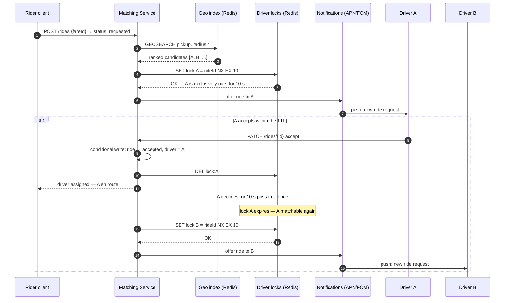
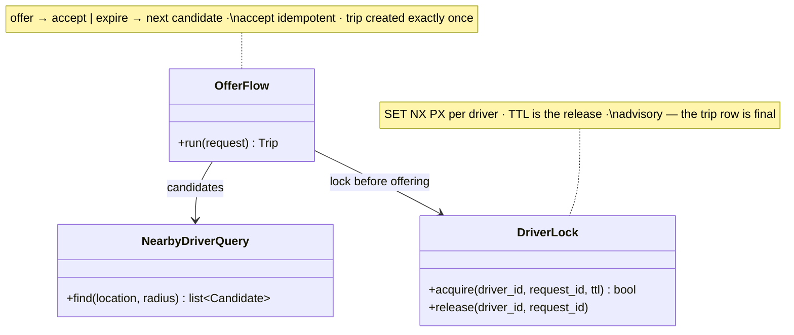

# 🚕 Design Uber

> **Prerequisites:** [Design Ticketmaster](/synapse/system-design-from-first-principles/case-studies/ticketmaster), [Design WhatsApp](/synapse/system-design-from-first-principles/case-studies/whatsapp) | **You'll be able to:** absorb millions of location writes per second with the right geo index and defend Redis GEO against quadtrees from first principles; run the driver-lock ladder and state precisely what a TTL lock does and does not guarantee; model the trip as a durable multi-step workflow that survives crashed services and silent drivers.

---

## 🧨 The problem (why this exists)

*"Design Uber"* — a ride-hailing platform: riders request a ride, the system matches a nearby available driver, the driver accepts and drives. This is the seventh rep of [the delivery framework](/synapse/system-design-from-first-principles/foundations/the-interview-at-10000-feet), and it introduces something no previous case study had: **the hot dataset is physical reality**. In [Ticketmaster](/synapse/system-design-from-first-principles/case-studies/ticketmaster) the contended inventory sat still in rows; in [YouTube](/synapse/system-design-from-first-principles/case-studies/youtube) the bytes were big but inert. Here, the data the whole design pivots on — where every driver is *right now* — changes every few seconds for millions of entities at once, is stale the moment you store it, and worthless an hour later. And the thing being allocated isn't a row but a human who can be in exactly one car at a time. Two hard problems, one system: a **geospatial firehose** on the write side, **matching contention** on the allocation side.

**Functional requirements:**

1. Riders can input a start location and destination and get a **fare estimate**.
2. Riders can **request a ride** based on that estimate.
3. Upon request, riders are **matched with a driver** who is nearby and available.
4. Drivers can **accept/decline** a request and navigate to pickup/drop-off.

*Below the line*: ratings in both directions, scheduled rides, ride categories (XL, Comfort). Name the rest out loud as out of scope — product thinking, cheaply demonstrated.

**Non-functional requirements — quantified:**

1. **Low-latency matching: under 1 minute to match — or to fail.** A bounded answer either way; a rider staring at a spinner has already opened a competitor's app. Per the [non-functional requirements](/synapse/system-design-from-first-principles/foundations/nonfunctional-requirements) discipline, the *"or failure"* clause is doing real work — it forces a deadline into the matching loop.
2. **Strong consistency in matching: no driver is ever assigned two rides simultaneously** — and, symmetrically, one ride is offered to one driver at a time. This is the CP corner, deliberately: a wrong match is worse than a slow one.
3. **High throughput at peak — 100k requests from the same location**: a stadium empties, and one geographic cell produces a city's worth of demand in minutes.

Read the three together and the interview's shape appears: NFR 3 says the load is *spatially skewed*, NFR 2 says allocation must be *exclusive*, NFR 1 says both must resolve in *seconds*. The rest of this lesson works out that triangle.

---

## 💡 Intuition first

Build the naive version. One Postgres database. A `drivers` table with `lat` and `lng` columns; every driver's phone POSTs its position every 5 seconds, each ping an `UPDATE drivers SET lat=?, lng=? WHERE id=?`. On a ride request, run `SELECT * FROM drivers WHERE available ORDER BY distance(lat, lng, ?, ?) LIMIT 10` and offer down the list.

It's honest, it demos fine with fifty drivers, and it dies twice at scale — the two deaths that define the first two deep dives.

**Death 1 — the write rate.** Put numbers on it: roughly **10 million drivers** pinging every 5 seconds is about **2 million location updates per second**. Sanity-check that against your [estimation instincts](/synapse/system-design-from-first-principles/foundations/estimation-and-numbers): a single beefy Postgres sustains on the order of tens of thousands of writes per second (rule of thumb, not from source) — two full orders of magnitude short, before a single rider has asked for anything. Even DynamoDB, which *can* scale to this, would cost around **$100k per day** at ~100-byte items. And notice what the writes are: each ping *overwrites* the last one; nobody will ever query where driver 483 was 40 seconds ago. We are paying durable-storage prices — WAL, replication, [B-tree maintenance](/synapse/system-design-from-first-principles/data-foundations/storage-engines) — for data whose value expires in seconds. Wrong store for the data's lifetime.

**Death 2 — the query shape.** *"Nearest available drivers"* is a two-dimensional proximity query, and B-trees index one dimension. An [index](/synapse/system-design-from-first-principles/data-foundations/indexing) on `lat` narrows to a horizontal band of the planet; the `lng` predicate then scans everything in that band — Vancouver matches a latitude band containing Newfoundland. B-tree indexes are not suited to multi-dimensional data, so without a purpose-built spatial index every match degenerates toward a scan with a distance computation per row, across millions of rows, on the critical path of a sub-minute SLA. Non-starter.

So the corrected instinct, one sentence per death: location data wants an **in-memory, spatially-indexed, self-expiring** store that absorbs the firehose and answers radius queries — not a relational table; the durable database holds only the **facts with a lifetime** — riders, drivers, fares, rides and their state. The rest of the design works out those two sentences, plus the problem the naive version hasn't even met yet: making sure two concurrent requests don't both *"win"* the same driver.

---

## ⚙️ How it works

### 🧱 Core entities: four facts and one firehose

Five entities carry this design; the architecture hides in the mismatch of their lifetimes:

- **Rider** — profile, payment method.
- **Driver** — profile, vehicle details, availability status.
- **Fare** — a priced quote: pickup, destination, estimated fare and ETA. Created before the ride exists; what the rider says yes to.
- **Ride** — the durable spine: rider, driver, the fare it was created from, **status**, route, timestamps. Every important transition in this design is a transition on this row.
- **Location** — driver's latest lat/lng plus timestamp. The odd one out: written 2M times a second, overwritten on every write, worthless when stale. The first four are rows; this one is a firehose wanting a different store.

### 🔌 The API — and what never crosses it

Per the [API design](/synapse/system-design-from-first-principles/foundations/api-design) discipline, the endpoints:

```
POST  /fare       { pickupLocation, destination }        → Fare (estimate + ETA)
POST  /rides      { fareId }                             → Ride (status: requested)
POST  /drivers/location   { lat, lng }                   → 200   // high-frequency
PATCH /rides/{rideId}     { action: accept | decline }   → Ride  // driver responds
```

A security note worth repeating in an interview: the client sends *nothing* the server can compute or already knows. No `userId` (session/JWT carries identity), no timestamps (server clocks), above all no `fareEstimate` — the fare is looked up by `fareId` server-side, because any price the client supplies is a price the client can edit.

### 🗺️ High-level architecture

Two clients, and behind the gateway a split that mirrors the entity analysis: a **Ride Service** owning the durable facts, a **Location Service** owning the firehose, a **Ride Matching Service** performing allocation, and a **Notification Service** delivering offers via APN/FCM push — the same last-mile delivery problem [WhatsApp](/synapse/system-design-from-first-principles/case-studies/whatsapp) solved with persistent connections, solved here with push because drivers can't hold open request connections all shift.

```d2
direction: right
classes: {
  client: {style: {fill: "#f3f4f6"; stroke: "#6b7280"}}
  edge:   {style: {fill: "#dbeafe"; stroke: "#2563eb"}}
  svc:    {style: {fill: "#dcfce7"; stroke: "#16a34a"}}
  data:   {style: {fill: "#ffedd5"; stroke: "#ea580c"}}
  async:  {style: {fill: "#f3e8ff"; stroke: "#9333ea"}}
}
rider: "Rider client" {class: client}
driver: "Driver client\npings location every ~5 s" {class: client}
gw: "API Gateway\nauth · rate limiting" {class: edge}
maps: "Third-party\nMapping API" {class: edge}
ride: "Ride Service\nfares · ride state" {class: svc}
loc: "Location Service\nabsorbs the ping firehose" {class: svc}
match: "Ride Matching Service\nranked candidates · offer loop" {class: svc}
notif: "Notification Service\nAPN / FCM" {class: svc}
db: "Ride DB (Postgres)\nriders · drivers · fares · rides" {class: data}
geo: "Geo index (Redis GEO)\nlatest position, TTL'd" {class: data}
locks: "Driver locks (Redis)\nSET NX, TTL 10 s" {class: data}
q: "Match queue (Kafka)\npartitioned by region" {class: async}
rider -> gw: "POST /fare · POST /rides"
driver -> gw: "pings · accept / decline"
gw -> ride: "fares, rides, accept"
gw -> loc: "location pings"
ride -> maps: "distance + ETA"
ride -> db: "Fare & Ride rows"
ride -> q: "enqueue match request"
q -> match: "consume; commit offset\nonly after match lands"
loc -> geo: "GEOADD driverId\n+ freshness TTL"
match -> geo: "GEOSEARCH around pickup"
match -> locks: "lock exactly one driver"
match -> notif: "offer to locked driver"
match -> db: "ride → matched / accepted"
notif -> driver: "push: ride offer" {style.stroke-dash: 3}
```

Walk the two journeys. **Fare & request:** the rider posts pickup and destination; the Ride Service gets distance and ETA from the mapping API, prices it, persists a Fare, returns it. The rider accepts; the Ride Service creates a Ride in `requested` and drops a match request onto the queue — queued, not called inline, so a surge buffers instead of overwhelming matching, and a crashed matcher's requests are re-consumed since the offset commits only after a match completes. **Ping & match:** drivers stream pings through the Location Service into the geo index; the matcher pulls a request, radius-queries for nearby available drivers, ranks them, and walks the list *one driver at a time* — lock, offer via push, wait 10 seconds, on decline or silence move on. Each verb — absorb, lock, walk — is a deep dive.

---

## 🤿 Deep dives

### 🌊 The location firehose: absorbing two million writes a second

The problem restated: 2M writes/second of overwrite-only, seconds-lived data, queried only as "who is within *r* of this point *right now*." The ladder builds in rungs.

**Rung 1 — keep the database, soften the blows: batch writes + a real spatial index.** Buffer pings and flush them in batches, cutting write transactions; replace the doomed B-tree with a **quadtree**-style spatial index — recursively partition the plane into four quadrants, subdividing where data is dense, so a proximity query descends straight to the leaf cells near the pickup point instead of scanning a latitude band. In Postgres this is the **PostGIS** extension. This rung is legitimately right *in a different problem*: for spatial data that is read-heavy and rarely moves — businesses on a map, houses for sale — an adaptive tree over durable rows is exactly right. Here it carries a poison pill: the batching interval is a staleness window — every second spent buffering is a second the *"nearest"* drivers are somewhere else — and quadtree rebalancing under constant movement means the index churns as fast as the data.

**Rung 2 — match the store to the data: in-memory geo index with TTL.** The landing solution is **Redis GEO**: `GEOADD` encodes each driver's lat/lng into a **geohash** — the two coordinates interleaved into one sortable value, so nearby points (edge cases aside) share prefixes — stored in a sorted set; `GEOSEARCH` (Redis ≥ 6.2, superseding `GEORADIUS`) answers radius and bounding-box queries directly against that structure. In-memory speed absorbs the write rate without batching, so no staleness window on the write path — and the design gets its most elegant piece for free: **a TTL as the freshness contract**. Expire each driver's entry if not refreshed: a driver whose app crashed, phone died, or tunnel swallowed the signal simply *ages out of matching* within one TTL. No health checker, no liveness protocol — absence of evidence becomes evidence of absence, enforced by the data's own lifecycle.

**The durability objection, inverted.** *"It's in memory — what if Redis dies?"* The deep insight of this dive: persistence (RDB snapshots / AOF) and Sentinel failover exist, but mostly *you don't need them* — every driver re-pings within ~5 seconds, so a cold replacement node rebuilds the whole working set in one ping interval. The data is self-healing because the source of truth was never the store; it's ten million phones. That's the general **write-absorption** pattern worth naming: when writes are high-frequency, low-value-per-write, and self-refreshing, absorb them in a volatile structure shaped like the query, and let durability live only where facts have a lifetime — the same instinct, opposite direction, as Ticketmaster moving hold-churn off the transactional tables.

**Geohash grid vs quadtree, settled honestly:** geohash is a *fixed* hierarchical grid — cheap, uniform, no rebalancing, indifferent to update rate, which is why it wins under constant movement; a quadtree is an *adaptive* partition — finer where data is dense, better for skewed static datasets, worse when the dataset is a swarm in motion. When the interviewer asks *"why not a quadtree?"*, the answer is update rate, not query power.

### 🤝 Matching and the driver lock: exactly one offer at a time

NFR 2 in mechanism form: when the matcher offers a ride, that driver must receive **no other offer** until they respond or 10 seconds elapse, and the ride is offered to one driver at a time. If you did [Ticketmaster](/synapse/system-design-from-first-principles/case-studies/ticketmaster), you have seen this exact problem: [an inventory unit claimable by exactly one party for a bounded window](/synapse/system-design-from-first-principles/patterns/dealing-with-contention). The seat became a driver, ten minutes became ten seconds, the inventory now drives around — but the ladder is the same. Climb it.

**Rung 1 — the lock in application memory.** Each matcher instance marks the driver *"offered"* in its own memory and starts a timer. Fails on arrival: matcher instances don't share memory, so two instances can both *"lock"* driver A — a race with no referee — and if an instance crashes after locking, no other instance knows the lock exists, stranding the driver. Local locks cannot coordinate a distributed decision.

**Rung 2 — the lock as a status column.** Move it into Postgres: transactionally set `driver.status = 'outstanding_request'` when offering. Coordination solved — the database serializes the matchers, exactly one transaction wins. But now *release* is the bug: the 10-second expiry lives in an in-memory timer, and if that process dies, the driver is locked forever. The patch — a cron sweeping expired locks — works but adds moving parts and sweep-lag during which drivers sit invisible.

**Rung 3 — the lock as a lease: Redis, `SET NX`, TTL 10 s.** The chosen design: to offer a ride, atomically set `lock:driverId → rideId` if absent, with a 10-second TTL. Acquisition failure means someone else holds the driver — skip to the next candidate. Accept in time → update the ride in the DB and delete the lock; silence → **the TTL is the release**, unconditionally, regardless of which processes have crashed. The status column solved coordination but left release in process memory; the TTL moves release into the store itself. The full loop, with the failure branch that makes it real:



**Now the honest part: what this lock does and does not guarantee.** A lock with a timeout is a **lease** — held by one node at a time, expiring unless renewed <abbr title="[pp. 366–367]">[i]</abbr> — and DDIA is blunt that distributed locks and leases are prone to misuse and a common source of serious bugs <abbr title="[p. 373]">[i]</abbr>. The canonical failure: your matcher acquires the lock on driver A, then stops — [a GC pause, a VM migration, paging](/synapse/system-design-from-first-principles/distributed-data/faults-clocks-and-time); multi-second pauses can strike between any two instructions, and the process resumes with no idea time passed <abbr title="[pp. 367–369]">[i]</abbr>. The TTL expires mid-pause; another matcher, correctly, locks A for a different ride. Your matcher resumes as a **zombie** — a former leaseholder that hasn't learned it lost the lease <abbr title="[p. 374]">[i]</abbr> — and keeps offering, or worse, assigning. DDIA's verdict: *it is not safe to assume only one node holds a lease at any moment* <abbr title="[p. 377]">[i]</abbr>. The robust general fix is a **fencing token** — a number increasing with each lock grant, carried on every downstream write, storage rejecting any write bearing a lower token than one already processed <abbr title="[p. 375]">[i]</abbr>; alternatively, storage supporting a conditional atomic compare-and-set write serves the same role <abbr title="[p. 376]">[i]</abbr>.

That alternative is exactly what this design has. The assignment that *counts* is not the Redis key — it's the ride row's transition, written conditionally: set `driver = A, status = accepted` only where the ride is still unassigned. A zombie's late write matches zero rows and bounces. Say the layering the way Ticketmaster taught: **the Redis lock is the experience** — no driver gets three simultaneous offer pings, no matcher wastes offers; **the conditional write in Postgres is the invariant** — exactly one driver ever assigned, even if every lease lies. Lose Redis entirely and you get messy offers for a few seconds, not double-booked drivers.

### 🧵 The trip is a workflow: failures at every arrow

Zoom out from one offer to the whole ride: `requested → matched → offered → accepted → en route → in ride → completed → paid`. Every arrow is a network hop, most involve a human, and the process spans an hour. The offer loop alone must survive its own executor dying — the pointed question: the driver drops the phone on the passenger seat and takes a break; who moves on to driver B if the matcher holding the 10-second timer has meanwhile crashed?

**Rung 1 — scheduled self-messages: the delay queue.** When offering to A, simultaneously schedule a delayed message (SQS-style, 10-second delay): *"if this ride is still unassigned, offer to the next driver."* Now the timeout is durable — any matcher instance can consume it. The costs: pending timers that must be *cancelled or made harmless* when the driver does accept, and the race where A accepts at second 9.8 while the delayed message is already firing — every edge needs explicit handling, and the workflow's real state ends up smeared across queues, timers, and DB columns.

**Rung 2 — durable execution.** The pattern this is groping toward has a name. A multi-step operation spanning services is a **workflow** — a graph of tasks — and a workflow engine decides when and where each task runs and what happens on failure <abbr title="[p. 187]">[i]</abbr>. **Durable-execution** engines (Temporal, Restate, AWS Step Functions) run the workflow as ordinary code but log every RPC and state change to durable storage, write-ahead-log style; when the executing process crashes, the framework re-executes the workflow *skipping* every step already completed — returning logged results instead of re-calling — which gives exactly-once semantics for the workflow as a whole <abbr title="[p. 188]">[i]</abbr>. The matching loop becomes eight readable lines — offer to A, await accept with a 10-second timeout, on timeout advance to B — and the timer, loop position, and retry logic all survive any instance dying, resumed by whichever worker picks the workflow up. Worth the pedigree: human-in-the-loop, long-lived processes are the signature use case, and Uber itself authored Cadence, the project that gave rise to Temporal.

**Two fine-print clauses, both from DDIA, both interview gold.** First, durable execution's replay only dedupes what the framework logged: any *external* service in the workflow — above all the payment gateway at `completed → paid` — must itself expose an [**idempotent**](/synapse/system-design-from-first-principles/patterns/idempotency-and-exactly-once) API, with the caller supplying unique IDs to make retried calls safe <abbr title="[pp. 188–189]">[i]</abbr>. That's the general truth about retries: a timed-out request may have succeeded, so retrying can execute the action twice unless idempotence is built into the protocol <abbr title="[p. 183]">[i]</abbr> — charge-the-rider is where that stops being abstract, and idempotency keys get their full treatment in the payments discussion later in the book. Second, replay re-runs your code deterministically, so nondeterminism — random numbers, reading the system clock — breaks it; frameworks ship deterministic substitutes you must remember to use, plus static analysis (Temporal's Workflow Check) to catch violations <abbr title="[p. 189]">[i]</abbr>.

The whole design as a **walkthrough** — three boards rather than one picture: the system in
context, its containers, and the code level inside the matching service. Any box carrying a link badge drills
down a level; the ◀ ▶ ⌂ controls and the board menu walk back out.

```d2 boards name="c4-uber" root="System Context"
direction: right

classes: {
  async:  { style: { fill: "#f3e8ff"; stroke: "#9333ea"; font-color: "#581c87" } }
  client: { style: { fill: "#f3f4f6"; stroke: "#6b7280"; font-color: "#111827" } }
  data:   { style: { fill: "#ffedd5"; stroke: "#ea580c"; font-color: "#7c2d12" } }
  edge:   { style: { fill: "#dbeafe"; stroke: "#2563eb"; font-color: "#1e3a8a" } }
  svc:    { style: { fill: "#dcfce7"; stroke: "#16a34a"; font-color: "#14532d" } }
}

rider: "Rider\n[Person]" {
  class: client
  shape: person
}

driver: "Driver\n[Person]" {
  class: client
  shape: person
}

sys: "Uber\n[Software System]" {
  class: svc
  link: layers.container
}

rider -> sys: "request ride · live status"
driver -> sys: "location pings · offers"

layers: {
  container: {
    direction: down

    rider: "Rider\n[Person]" {
      class: client
      shape: person
    }

    driver: "Driver\n[Person]" {
      class: client
      shape: person
    }

    gw: "API gateway\n[Gateway]" {
      class: edge
    }

    loc: "Location service\n[Python · FastAPI]" {
      class: svc
    }

    geo: "Geo index\n[Redis GEO]" {
      class: data
      shape: cylinder
    }

    match: "Matching service\n[Python · FastAPI]" {
      class: svc
      link: _.layers.code
    }

    locks: "Driver locks\n[Redis (SET NX PX)]" {
      class: data
      shape: cylinder
    }

    trip: "Trip service\n[Python · FastAPI]" {
      class: svc
    }

    trip_db: "Trip DB\n[PostgreSQL]" {
      class: data
      shape: cylinder
    }

    notify: "Notification & live channel\n[APN/FCM push + WebSocket]" {
      class: async
    }

    gw -> loc: "driver pings"
    loc -> geo: "TTL'd position writes"
    gw -> match: "ride requests"
    match -> geo: "nearby-driver queries"
    match -> locks: "acquire / release offer lock"
    match -> notify: "push offer to driver"
    match -> trip: "accepted → create trip"
    trip -> trip_db: "state transitions"
    trip -> notify: "status to rider"
  }

  code: {
    direction: down

    match: "Matching service\n[Python · FastAPI]" {
      class: svc

      nearby_driver_query: "NearbyDriverQuery" {
        class: svc
        link: "https://github.com/ani2fun/system-design-guide/blob/main/_proof-of-concepts/06-case-studies/07-uber/domain/nearby_driver_query.py"
      }
      driver_lock: "DriverLock" {
        class: svc
        link: "https://github.com/ani2fun/system-design-guide/blob/main/_proof-of-concepts/06-case-studies/07-uber/domain/driver_lock.py"
      }
      offer_flow: "OfferFlow" {
        class: svc
        link: "https://github.com/ani2fun/system-design-guide/blob/main/_proof-of-concepts/06-case-studies/07-uber/domain/offer_flow.py"
      }
    }

    geo: "Geo index\n[Redis GEO]" {
      class: data
      shape: cylinder
    }

    locks: "Driver locks\n[Redis (SET NX PX)]" {
      class: data
      shape: cylinder
    }

    trip: "Trip service\n[Python · FastAPI]" {
      class: svc
    }

    notify: "Notification & live channel\n[APN/FCM push + WebSocket]" {
      class: async
    }

    match.offer_flow -> match.nearby_driver_query: "candidates"
    match.offer_flow -> match.driver_lock: "lock before offering"
    match -> notify: "push offer to driver"
    trip -> notify: "status to rider"
    match.driver_lock -> locks: "SET NX PX / DEL"
    match.nearby_driver_query -> geo: "GEOSEARCH"
    match.offer_flow -> trip: "create trip (idempotent)"
  }
}
```

### 🛠️ Hands-on: run this design

A **runnable implementation** of the matching core lives at `_proof-of-concepts/07-case-studies/07-uber/` in the repo root — the three classes above (`NearbyDriverQuery`, `DriverLock`, `OfferFlow`), over Redis GEO + Redis locks + Postgres.

```bash
cd _proof-of-concepts/07-case-studies/07-uber
./run            # build + start api (8380) + Redis (8381) + Postgres (8382)
./run test       # mypy --strict + smoke
./run stop
```

`./run test` makes the contention concrete: retrying the same ride request returns the **same trip** (exactly-once, backed by `UNIQUE(request_id)`); and 8 riders scrambling for 5 drivers, fired concurrently, produce exactly **5 matches to 5 distinct drivers** — no driver offered to two riders — while the other 3 get a clean *"no driver available"*. The per-driver `SET NX` lock is what serialises the offer.

---

## 🧱 Component reference

<details>
<summary>14 components — what each one owns, the invariant it protects, and where it breaks</summary>

### 👤 Rider
`Actor` · `Human · rider app`

The **Rider** asks one question — *"get me from here to there"* — and then does something the system must design around: they *wait, watching*. From the tap on *"request"* to a driver assignment, the rider stares at a live status screen, which turns matching into a sub-minute, user-visible SLA rather than a background job. A fare quote precedes everything: the rider says yes to a **priced** trip, not to an open-ended meter.

**Responsibilities**

- Request a fare quote (pickup + destination) and accept it — creating the ride against that `fareId`, never against a client-supplied price.
- Send *nothing* the server can compute or already knows: identity rides in the session, timestamps come from server clocks, and above all the fare is looked up server-side — any price the client supplies is a price the client can edit.
- Watch ride status live over the realtime channel: requested → matched → en route → in ride → completed.

**Where it breaks.** Impatience and retries. A rider who taps *"request"* twice, or whose app retries a timed-out POST, must not spawn two rides — which is why ride creation is idempotent per request downstream. And riders cluster: a stadium emptying puts a hundred thousand of them in one geohash cell at once, the hot-zone burst the queue in front of matching exists to absorb.

### 👤 Driver
`Actor` · `Human · driver app, GPS on`

The **Driver** is two very different clients in one phone. As a *sensor*, the app streams a location ping every ~5 seconds all shift — across a fleet of roughly 10 million drivers, about 2 million writes per second of overwrite-only data that is worthless within seconds. As a *scarce resource*, the driver is the inventory being allocated: when a ride is offered, this driver must see **exactly one offer at a time**, with 10 seconds to accept or decline before the system moves on.

**Responsibilities**

- Stream location pings on a fixed interval while available — the firehose the Location service exists to absorb.
- Receive at most one offer at a time (enforced by the per-driver TTL lock) and answer it within the offer window; silence counts as decline.
- Accept or decline via the ride endpoint; an accept may be retried safely — assignment is idempotent downstream.

**Where it breaks.** This actor's phone is the least reliable component in the system: apps crash, batteries die, tunnels swallow signal. The design refuses to build a liveness protocol around that — a driver who stops pinging simply *ages out* of the geo index within one TTL, and an offer to a driver who went dark expires on its own lock TTL. Absence of evidence becomes evidence of absence, enforced by the data's own lifecycle.

### 🏢 Uber
`System` · `Gateway + FastAPI services + Redis + PostgreSQL`

**Geospatial matching under contention**: find nearby drivers fast, offer to exactly one, survive the hot zone. The architecture falls out of one observation about the entities — four of them (rider, driver, fare, ride) are *facts with a lifetime* that belong in rows; the fifth, driver location, is a **firehose**: written ~2M times a second, overwritten on every write, worthless when stale. Splitting those two lifetimes into different stores is most of the design.

**Responsibilities**

- **Absorb the firehose** on a dedicated write path: pings flow through the Location service into a TTL'd in-memory geo index — nothing durable ever sees them.
- **Allocate under contention**: the Matching service radius-queries candidates, takes a per-driver TTL lock so no driver gets simultaneous offers, and walks the ranked list one offer at a time.
- **Own the durable spine**: the Trip service runs the ride's state machine, with PostgreSQL as the system of record and the final arbiter of who got the ride.
- **Deliver in real time**: offers to drivers, live status to riders.

The layering to say out loud: **Redis is the experience; Postgres is the invariant.** TTLs make freshness and lock-release automatic; the conditional trip write makes *"one driver per ride"* true even if every lease lies.

**Where it breaks.** Hot zones — a stadium emptying concentrates riders and a knot of drivers into one geohash cell, textbook skew that uniform sharding cannot fix; the answers are queue-buffered matching, subdividing hot cells, and geographic partitioning so one city's meltdown stays local.

### 🚪 API gateway
`API gateway` · `Gateway`

The **API gateway** fronts both apps and terminates the realtime channels — one entry point, two radically different traffic shapes behind it. Rider traffic is low-rate and transactional (a fare quote, a ride request, an occasional cancel); driver traffic is the ping firehose, high-frequency and fire-and-forget. The gateway's most important routing decision is keeping those apart: pings go straight to the Location service's dedicated write path, ride requests go to the Matching service, and neither queue ever blocks the other.

**Responsibilities**

- Authenticate every request and attach identity server-side — the client never supplies a `userId`, a timestamp, or (above all) a fare amount; anything the client could edit, the gateway's session context or a server-side lookup provides instead.
- Rate-limit per client, which matters most on the ping path: a misbehaving driver app re-sending at 10× the interval is throttled at the edge, not absorbed downstream.
- Route by traffic class: high-frequency location writes to the Location service, ride lifecycle calls to Matching and Trip, and hold the persistent connections the Realtime channel pushes through.

**Where it grows.** Horizontally and statelessly — the gateway holds no ride state, so instances multiply behind a load balancer as the fleet grows. The pressure point is connection count, not CPU: every online driver and every waiting rider holds a realtime connection, so the gateway tier's sizing follows the fleet, not the request rate.

### ⚙️ Location service
`Service` · `Python · FastAPI`

The **Location service** exists for one reason: the ping firehose must not touch anything else. Roughly 10 million drivers pinging every 5 seconds is about **2 million writes per second** — two orders of magnitude beyond what a durable relational store sustains, and the naive design dies here first. Worse, the writes are unlike everything else in the system: each ping *overwrites* the last, nobody ever queries where a driver was 40 seconds ago, and the value expires in seconds. Paying durable-storage prices — WAL, replication, B-tree maintenance — for that data is the wrong store for the data's lifetime. So this container is the firehose's **only** consumer: a thin, stateless write path that nothing else shares.

**Responsibilities**

- Accept every driver ping from the gateway and turn it into a `GEOADD` plus a freshness TTL on the geo index — write-through, no batching, so there is no staleness window on the write path.
- Do nothing else. No reads, no ride logic, no durable writes; its isolation *is* the design decision.

**Where it grows.** Horizontally without ceremony — it holds no state, so instances scale with ping volume; the real lever is upstream, where adaptive ping intervals (stationary drivers ping rarely, fast movers often) cut the write rate at the source.

**Where it breaks.** If it backs up, the geo index goes stale and matching quietly degrades — offers go to drivers who have moved on. The TTL bounds the damage: positions that stop refreshing evaporate rather than lie.

### ⚡ Geo index
`Cache` · `Redis GEO`

The **Geo index** is the store shaped like the question: "who's nearby, *right now*?" `GEOADD` encodes each driver's lat/lng as a **geohash** — coordinates interleaved into one sortable value, so nearby points (edge cases aside) share prefixes — in a sorted set; `GEOSEARCH` answers radius queries directly against that structure. In-memory speed absorbs the full 2M-writes/second firehose with no batching, where a B-tree over `lat`/`lng` degenerates to scanning a latitude band, and a quadtree — right for skewed, *static* spatial data — churns endlessly under a swarm in motion. Geohash's fixed grid is indifferent to update rate, which is exactly why it wins here.

**Responsibilities**

- Hold each driver's latest position, overwritten per ping — never a history.
- Enforce **freshness by TTL**: an entry not refreshed within the window simply expires, so a crashed app or a tunnel removes its driver from matching with no health checker and no liveness protocol. Stale drivers evaporate.
- Answer the Matching service's radius queries as the candidate source.

**Where it breaks — and why that's fine.** It's volatile, and the design leans into it: persistence and failover exist, but a cold replacement node rebuilds the entire working set in one ~5-second ping interval, because the source of truth was never Redis — it's ten million phones. The honest costs are cell-boundary queries needing care, and hot cells (a stadium's geohash) concentrating load that uniform sharding can't spread — subdivide the hot cell instead.

### ⚙️ Matching service
`Service` · `Python · FastAPI`

The **Matching service** is the contention core — where a scarce, moving inventory (drivers) meets concurrent claimants (ride requests). If you did Ticketmaster, you've seen the shape: an inventory unit claimable by exactly one party for a bounded window. The seat became a driver, ten minutes became ten seconds, the inventory now drives around — the ladder is the same.

**Responsibilities**

- Radius-query the geo index for nearby available drivers and rank them (ETA, rating).
- Take the per-driver **TTL lock** before every offer — the guarantee that no driver ever sees two simultaneous offers, and that a crashed matcher's lock releases itself by expiry.
- Walk the offer chain *one driver at a time*: offer, wait out the 10-second window, on decline or silence move to the next candidate.
- On accept, hand off to the Trip service — whose conditional, constraint-backed write is the **final arbiter**; the Redis lock is the experience, the trip row is the invariant.

Three classes carry that loop:



Each class maps to a file in the forthcoming POC at `06-case-studies/examples/uber/app/` — click the code-level boxes for their docs.

**Where it breaks.** The lease that lies: a GC-paused matcher can resume as a zombie, still acting on a lock that expired mid-pause. The design survives because assignment never trusts the lock — the zombie's late write matches zero rows downstream. And hot zones: one stadium's worth of requests converging on one cell is why matching sits behind a buffer, degrading to latency instead of dropped requests.

### 🧩 NearbyDriverQuery
`Code` · `Python`

**NearbyDriverQuery** answers the question that kills the naive design: "which available drivers are within *r* of this pickup, *right now*?" — as a `GEOSEARCH` against the geo index plus ranking (ETA, rating) over the hits. It is deliberately read-only and deliberately dumb about freshness.

**Responsibilities**

- `find(location, radius)`: radius query against the geo index, returning ranked candidates for the offer flow to walk.
- Rank, don't reserve: this class never touches locks or trips — it produces candidates; `DriverLock` and `OfferFlow` decide what happens to them.

**The invariant it relies on:** freshness comes from the **index TTLs, not from the query**. `find` never checks whether a driver is alive, recently seen, or still where the entry says — it doesn't have to, because any entry not refreshed within one ping interval has already evaporated. The class inherits liveness from the data's own lifecycle, which is why it can stay a single read with no health-check round-trips on the sub-minute matching path.

**Where it breaks.** Its answers are bounded-stale by construction — a candidate at ~50 km/h moves ~70 m between 5-second pings, noise against a kilometer-scale radius but real at pickup precision. And geohash cell boundaries can clip a radius query, so near-boundary searches need care. Both are accepted costs, not bugs: candidates are *offers to attempt*, and the lock + conditional trip write downstream absorb any staleness. Lands in the forthcoming POC at `06-case-studies/examples/uber/app/nearby_driver_query.py`.

### 🧩 DriverLock
`Code` · `Python`

**DriverLock** is the offer-window lease: one atomic `SET NX PX` per driver — Ticketmaster's `SeatHoldService` wearing a different hat, with the hold window shrunk from ten minutes to ten seconds and the inventory now driving around.

**Responsibilities**

- `acquire(driver_id, request_id, ttl)`: set `lock:driverId → rideId` only if absent, with expiry — two matchers racing for the same driver get exactly one winner, decided by Redis's atomic set, no check-then-set window.
- `release(driver_id, request_id)`: drop the lock on accept or explicit decline; otherwise do nothing — expiry handles it.

**The invariants it protects:** a driver holds at most **one outstanding offer at a time**, and no lock outlives its TTL — so a matcher that crashes mid-offer releases its driver by *expiry, not cleanup code*. Crashed flows self-heal; there is no sweeper, no orphan-lock cron, no sweep-lag during which drivers sit invisible.

**And the one it deliberately doesn't:** this lock is **advisory, not final**. It is a lease, and leases lie — a GC-paused matcher can resume after its TTL as a zombie leaseholder, so it is not safe to assume only one holder at any instant. The class carries no fencing tokens and no consensus, because the design puts the real guarantee elsewhere: the conditional trip write in Postgres is the final arbiter, and a zombie's late assignment matches zero rows. Lose this class entirely and drivers get messy duplicate offers — never double-booked.

**Where it breaks.** Exactly at that seam: anyone who treats `acquire` returning `True` as proof of exclusive assignment has rebuilt the bug the layering exists to prevent. Lands in the forthcoming POC at `06-case-studies/examples/uber/app/driver_lock.py`.

### 🧩 OfferFlow
`Code` · `Python`

**OfferFlow** is the allocation loop written as readable code: get candidates, then walk them one at a time — lock, offer, await accept within the window; on decline or expiry, advance to the next. It composes the other two classes and owns the sequencing they deliberately don't.

**Responsibilities**

- `run(request) → Trip`: pull ranked candidates from `NearbyDriverQuery`, and for each: `DriverLock.acquire` first (an offer without a lock could double-offer a driver), push the offer, wait out the window, and either hand off to trip creation or move on. Lock-acquisition failure just means someone else holds that driver — skip, don't wait.
- Keep **accept idempotent**: a retried accept (flaky driver network, duplicate tap) converges on the same result instead of erroring or duplicating.
- Create the trip **exactly once per request** — the write goes through the Trip service against the Trip DB's per-request unique constraint, so even a zombie flow replaying an assignment matches zero rows.

**The invariant it protects:** every ride request produces at most one trip, and every accepted offer produces exactly one — no matter how many retries, duplicate accepts, or crashed-and-resumed flows occur along the way. The loop's *liveness* (who advances to driver B if this executor dies mid-window?) is the workflow problem the lesson resolves with durable timeouts or durable execution; its *safety* never depends on the executor surviving, because it rests on the DB constraint.

**Where it breaks.** On deadline math: the sub-minute match SLA affords only ~5 sequential silent-driver hops at 10 seconds each — ranking quality, not loop mechanics, decides whether the walk finishes in time. Lands in the forthcoming POC at `06-case-studies/examples/uber/app/offer_flow.py`.

### ⚡ Driver locks
`Cache` · `Redis (SET NX PX)`

One key per driver, `SET NX PX`: the **offer-window lock** that guarantees a driver receives exactly one offer at a time. It's Ticketmaster's seat hold wearing a different hat — same atomic acquire, same TTL release — and it beat two rivals to get here. A lock in matcher memory fails on arrival: instances don't share memory, so two matchers can both *"lock"* driver A, and a crash strands the driver. A status column in Postgres fixes coordination but breaks *release* — the 10-second expiry lives in an in-memory timer, so a dead process locks the driver forever, patchable only with sweep-lag crons. The TTL lease moves release into the store itself.

**Responsibilities**

- Atomic acquire: set `lock:driverId → rideId` only if absent, TTL 10 s — two matchers racing for the same driver get exactly one winner.
- **TTL is the release**: accept in time and the matcher deletes the lock; silence, decline, or a crashed matcher, and expiry frees the driver unconditionally — no cleanup code, no sweeper.
- Stay **advisory**: the trip-creation transaction remains the final arbiter of who got the ride.

**Where it breaks.** A lease is not a guarantee: a paused matcher can outlive its TTL and resume as a zombie leaseholder, and a failover can forget grants. Both cost UX only — a stray duplicate offer for a few seconds — because the conditional trip write downstream fences the consequences. Lose this store entirely and you get messy offers, never a double-booked driver.

### ⚙️ Trip service
`Service` · `Python · FastAPI`

The **Trip service** owns the ride's durable spine: `requested → matched → accepted → en route → in ride → completed`, with failure arrows at every step. Every arrow is a network hop, most involve a human, and the whole process spans an hour — which makes the ride a **workflow**, not a request. The pointed failure case: a driver drops the phone on the passenger seat; who moves on to the next driver if the matcher holding the 10-second timer has meanwhile crashed? Timers, loop position, and retries must survive any single process dying — via durable timeouts (delayed messages) or a durable-execution engine that logs every step and replays past completed ones on recovery.

**Responsibilities**

- Execute state transitions as **conditional writes**: assign a driver only where the ride is still unassigned — this, not the Redis lock, is what makes *"exactly one driver per ride"* true. A zombie matcher's late write matches zero rows and bounces.
- Create each trip **exactly once per request**, backed by the Trip DB's unique constraint, so retried accepts are safe.
- Push status to the rider over the realtime channel at every transition.

**Where it breaks.** At the workflow's external edges: replay and retries only dedupe what the system itself logs, so any outside call — above all payment at `completed → paid` — must expose an idempotent API with caller-supplied keys, or a retry becomes a double charge. Inside the boundary, the DB constraint holds the line.

### 🗄️ Trip DB
`Relational database` · `PostgreSQL`

The **Trip DB** is the system of record for the facts with a lifetime — riders, drivers, fares, trips and their state — everything the entity analysis kept *out* of the firehose path. It is deliberately boring: while location data gets an exotic in-memory store because of its write rate and shelf life, the durable facts arrive at human tempo (a trip transitions a handful of times over an hour) and demand exactly what a relational database sells — transactions, constraints, conditional writes.

**Responsibilities**

- Hold the trip row as the ride's single durable spine; every state transition in the design is ultimately a transition on this row.
- Enforce **one trip per request** via a unique constraint — the mechanism behind OfferFlow's exactly-once trip creation; a retried accept hits the constraint instead of creating a duplicate.
- Back the **conditional write** that is the design's true invariant: assign a driver only where the trip is still unassigned, so a zombie matcher acting on an expired lease matches zero rows.

The layering, said once more: everything upstream — geo index, TTL locks, offer pushes — is *experience*; this container is the *invariant*. Lose Redis and you get a few seconds of messy offers; lose the constraint here and you double-book drivers.

**Where it breaks.** Not on write volume — successful matches are a trickle next to the ping firehose — but on contention in hot zones, where thousands of concurrent transitions converge; the queue ahead of matching meters arrivals so its short transactions stay short.

### 🔔 Realtime channel
`Notification service` · `WebSocket / push`

The **Realtime channel** solves the last mile in both directions: the *offer* must reach a specific driver's phone within a 10-second window, and the *status* must reach a rider who is staring at the screen. Neither party can poll for this — the offer window is too short and the audience too large — so the server must be able to reach out first: push notifications (APN/FCM) for drivers who can't hold open request connections all shift, persistent connections for riders watching a live screen. It's the same last-mile delivery problem WhatsApp solved with persistent connections, met here with the delivery mechanism each client can sustain.

**Responsibilities**

- Deliver ride offers to the one locked driver, fast enough that delivery latency doesn't eat the 10-second offer window.
- Stream status transitions to the waiting rider — requested, matched, driver en route — as the Trip service emits them.
- Carry no decisions: this container is transport. Locks decide who gets the offer; the trip row decides who got the ride.

**Where it breaks.** Delivery is best-effort by nature — a push can arrive late or never, and the design must not depend on it. It doesn't: an undelivered offer simply expires with the driver lock's TTL and the flow walks on to the next candidate; a missed status update is repaired by the next one. Every failure here degrades to waiting, never to inconsistency.

</details>

## ⚖️ Trade-offs

| Option | Gives you | Costs you | Use when |
| --- | --- | --- | --- |
| Postgres/PostGIS, batched writes | One database; durable locations; real spatial index | Staleness = batch interval; write ceiling still looms; index churn under movement | Modest fleet, or spatial data that rarely moves |
| Quadtree-based index | Adaptive resolution where data is dense; strong for skewed, static datasets | Rebalances constantly under a moving swarm; another service to run | Read-heavy spatial search over slowly-changing entities |
| Redis GEO + TTL | Absorbs full write rate; radius queries native; TTL = free liveness; rebuilds in one ping interval | Volatile (needs RDB/AOF/Sentinel if you care); one more store; cell-boundary queries need care | High-frequency, self-refreshing location data — this problem |
| Driver lock: DB status column | Correct coordination via transactions; no new infra | Release depends on in-memory timers or sweep-lag crons; stranded locks on crash | Low contention, coarse windows, minimal stack |
| Driver lock: Redis `SET NX` + TTL | Atomic acquire; expiry survives any crash; lock churn off the DB | A lease, not a guarantee — zombies possible <abbr title="[p. 377]">[i]</abbr>; needs the DB conditional write as backstop | Short exclusive windows at scale — this problem |
| Fixed 5 s ping interval | Simple; bounded staleness everywhere | 2M writes/s at fleet scale; battery + bandwidth burn for parked drivers | Small fleets, or as the baseline you then optimize |
| Adaptive ping interval | Big write reduction — stationary drivers ping rarely, fast movers often | On-device logic to design, test, and trust | Fleet scale, where the write rate is a cost center |

---

## 🔢 Numbers that matter

- **~10M drivers × 1 ping / 5 s ≈ 2M location writes/second** — the number that kills the naive design; recite the arithmetic, not just the conclusion.
- **~$100k/day** — the DynamoDB estimate for absorbing that write rate naively (~100-byte items): *"technically possible"* is not *"defensible."*
- **Match-or-fail < 1 min; offer window 10 s.** Derived corollary: the offer loop gets at most ~5 sequential silent-driver hops before the deadline — rank candidates well (derived arithmetic, not from source).
- **100k requests from one location** at a peak event — the number justifying the queue in front of matching and the hot-zone discussion below.
- **Staleness ≈ speed × ping interval** (derived): a car at ~50 km/h (~14 m/s) moves ~70 m between 5-second pings, ~140 m at 10 seconds. Against a 1 km match radius, either is noise — why adaptive intervals are nearly free: precision matters at pickup, not candidate selection.
- **Geo-index footprint**: 10M entries × ~100 B ≈ ~1 GB — one Redis node's memory, not a cluster problem (rule of thumb, not from source).

---

## 🏭 In production

**Hot zones are the real test.** The stadium empties: tens of thousands of riders and a knot of drivers in one geohash cell. This is textbook **skew** — a *hot spot* is a shard with disproportionate load; a single key with extreme load is a *hot key* <abbr title="[pp. 255–256]">[i]</abbr> — and hashing doesn't save you, because uniform key-spreading does nothing when the workload itself concentrates on one key, DDIA's celebrity problem wearing GPS coordinates <abbr title="[p. 263]">[i]</abbr>. The mitigations are the chapter's own: isolate the hot cell onto dedicated capacity, or subdivide it into finer sub-cells across shards — the spatial analogue of key salting, paying with fan-out on reads <abbr title="[p. 264]">[i]</abbr>. The queue in front of matching absorbs the burst's *arrival* so matchers degrade to higher latency instead of dropped requests, and geographic partitioning of services, queues, and stores keeps one city's meltdown from browning out another — scatter-gather only when a pickup sits on a shard boundary. At the marketplace layer, ride-hailing platforms famously use dynamic (*"surge"*) pricing as a demand valve and supply magnet in these moments — a product lever doing load-shedding's job (rule of thumb, not from source; treat any real company's pricing specifics as unknown).

**GPS lies a little.** Urban canyons bounce signals off glass towers; raw pings put drivers inside buildings or rivers. Production systems map-match — snap pings to the road network before indexing or ETA math (rule of thumb, not from source). The client is a design surface too: adaptive on-device ping logic (stationary drivers ping rarely; fast movers ping often) cuts the firehose at its source.

**Watch the funnel, not the servers.** This system's health is a funnel of matching outcomes: time-to-match percentiles against the 1-minute SLA (discipline per [latency, throughput & percentiles](/synapse/system-design-from-first-principles/foundations/latency-throughput-percentiles)), first-offer acceptance rate (every decline burns 10 seconds of a 60-second budget), lock-contention rate on drivers (rising contention = supply crunch), and geo-index freshness at query time. This paragraph is operational rule of thumb, not from source. One production fact worth naming: the workflow problem is real enough that Uber built Cadence — the durable-execution engine that begat Temporal — for use cases exactly like this.

---

## 🪤 Pitfalls & interview traps

- **Quoting the fix without the numbers.** *"I'd use Redis GEO"* earns nothing by itself. The senior move is the arithmetic — 10M drivers / 5 s → 2M writes/s against a relational write ceiling — *then* the fix, then the quadtree-vs-geohash trade-off when probed.
- **Treating the driver lock as correctness.** The follow-up is scripted: *"your matcher GC-pauses for 12 seconds while holding the lock — what happens?"* If your answer depends on the lock being exclusive, you've been had; leases expire on schedule, zombies resume without noticing <abbr title="[p. 374]">[i]</abbr>, and only a fencing token or a downstream conditional write makes the invariant hold <abbr title="[pp. 375–376]">[i]</abbr>.
- **Forgetting the TTL on locations.** A geo index without expiry matches riders with drivers whose app died an hour ago. Freshness must be enforced by the store, not assumed of the fleet — which is exactly why the TTL lands here.
- **In-memory timers for the offer window.** Rung 2 of the lock ladder in disguise: any timeout that matters must live in durable or self-expiring form — a TTL, a delayed message, a workflow timer — never in the RAM of a process that might die (<abbr title="[p. 188]">[i]</abbr> for the workflow form).
- **Trusting the client.** Accepting `fareEstimate` — or any price, identity, or timestamp — from the request body is the named red flag: everything the server can derive, the server must derive.

<div style="border-left:4px solid #da5233;background:rgba(218,82,51,0.08);padding:0.6rem 1rem;border-radius:0 0.5rem 0.5rem 0;margin:1.25rem 0">

⚠️ **The lock is not the invariant.** A TTL lock is a *lease*, and DDIA's warning is unconditional: it is not safe to assume only one node holds a lease at a time <abbr title="[p. 377]">[i]</abbr>. The Redis driver lock buys a clean offer experience; the guarantee that no driver is ever double-assigned must come from a fenced or conditional write at the system of record <abbr title="[pp. 375–376]">[i]</abbr>. Say both halves in the interview — candidates who only say the first half get the GC-pause question, and deserve it.

</div>

---

## ✅ Check yourself

```quiz
{"prompt": "Your naive design writes every driver ping as an UPDATE to a Postgres drivers table. At 10M drivers pinging every 5 seconds, what breaks first, and why?", "options": ["Storage volume — location rows accumulate faster than disks grow", "Write throughput — ~2M updates/sec is orders of magnitude beyond a relational database, before query costs even start", "Read latency — riders' SELECTs block behind the writes", "Nothing, if you add a read replica for the proximity queries"], "answer": "Write throughput — ~2M updates/sec is orders of magnitude beyond a relational database, before query costs even start"}
```

```quiz
{"prompt": "Why does Redis GEO put a TTL on each driver's location entry?", "options": ["To cap Redis memory usage as the fleet grows", "To force drivers to re-authenticate periodically", "So a driver whose app crashed or lost signal ages out of matching automatically — freshness enforced by the data's own lifecycle, with no health-check protocol", "To comply with location-data retention regulations"], "answer": "So a driver whose app crashed or lost signal ages out of matching automatically — freshness enforced by the data's own lifecycle, with no health-check protocol"}
```

```quiz
{"prompt": "A matcher acquires the Redis lock on driver A (TTL 10 s), then GC-pauses for 15 seconds. A second matcher locks A for a different ride. The first matcher resumes and tries to assign A. What actually prevents a double assignment?", "options": ["Redis rejects the zombie because it remembers the original lock holder", "Nothing — this design double-assigns drivers under GC pauses", "The TTL guarantees the lock stays valid while its holder is processing", "The conditional write on the ride row: the zombie's late update matches zero rows, so the lease's lie never reaches the system of record"], "answer": "The conditional write on the ride row: the zombie's late update matches zero rows, so the lease's lie never reaches the system of record"}
```

```quiz
{"prompt": "The matching workflow runs on a durable-execution engine and crashes right after driver A accepted but before the payment step. What happens on recovery?", "options": ["The workflow restarts from the beginning, re-offering the ride to driver A", "The framework replays the workflow, skipping logged steps and returning their recorded results, then continues from the payment step — which must be idempotent since it calls an external gateway", "The ride is lost, because workflow state lived in the crashed worker's memory", "The payment is exactly-once by the engine alone, with no requirements on the gateway"], "answer": "The framework replays the workflow, skipping logged steps and returning their recorded results, then continues from the payment step — which must be idempotent since it calls an external gateway"}
```

**Prose questions:**

1. *A stadium empties and 100k ride requests hit one geohash cell within minutes. Walk the failure from geo index to matcher to driver supply, naming one mitigation per layer.*

<details>
<summary>Answer</summary>

The cell is a textbook hot spot <abbr title="[pp. 255–256]">[i]</abbr>: uniform hashing can't help because the workload itself concentrates on one key <abbr title="[p. 263]">[i]</abbr>. **Index layer:** every match hits the same cell — isolate it on dedicated capacity or subdivide it into sub-cells spread across shards (spatial key-salting), paying with scatter-gather on reads <abbr title="[p. 264]">[i]</abbr>. **Matching layer:** requests outrun matcher throughput — the Kafka queue absorbs the burst so requests queue rather than drop, matchers scale out on queue depth, and offsets committing only after a match means a crashed matcher loses nothing. **Supply layer:** no architecture conjures cars; the marketplace lever is dynamic pricing to shed demand and attract drivers (rule of thumb, not from source). The layered answer — index, service, marketplace — separates a systems answer from "add more servers."

</details>

2. *Product asks you to halve location-write volume by pinging every 10 seconds instead of 5. What does it cost, and is there a better cut?*

<details>
<summary>Answer</summary>

Staleness ≈ speed × interval: at ~50 km/h a driver moves ~70 m between 5-second pings, ~140 m at 10 seconds (derived arithmetic). Against a ~1 km matching radius, 140 m barely changes candidate selection; the damage shows up in *pickup* precision, ETA quality, and how long a vanished driver stays matchable (one TTL, now twice as long). The better cut is an adaptive interval: ping rate as a function of movement — a parked driver pings rarely, a highway driver every few seconds. Most of a fleet is slow or stationary at any moment, so the reduction is comparable or better with almost no staleness cost where it matters; the price is on-device logic that must be designed and trusted. Both schemes are *client-side* fixes — a reminder that the client is part of the system.

</details>

---

## 🔬 PoC — Proof of concepts

**Run it yourself.** [Uber — geospatial matching](https://github.com/ani2fun/system-design-guide/tree/main/_proof-of-concepts/07-case-studies/07-uber)
— riders and drivers on a grid, matched under contention so two riders never grab the same driver;
the proximity search plus the concurrency guard together. From
`_proof-of-concepts/07-case-studies/07-uber/`, run `./run`.

**Study real implementations.**

- [Uber H3](https://github.com/uber/h3) — the hexagonal geospatial index Uber built for exactly this:
  bucket the world into cells so *"drivers near me"* is a cell lookup, not a full scan.
- [PostGIS](https://github.com/postgis/postgis) — the alternative if you stay in SQL: spatial types
  and GiST indexes for `ST_DWithin` proximity queries.
- [Redis](https://github.com/redis/redis) — geospatial commands (`GEOADD`/`GEOSEARCH`) for the
  fast-moving, in-memory index of live driver positions.

---

## 📚 Sources

DDIA2 ch. 9 pp. 366–369, 373–377 (locks, leases, process pauses, zombies & fencing) · DDIA2 ch. 5 pp. 183, 187–189 (retries & idempotence, workflows & durable execution) · DDIA2 ch. 7 pp. 255–256, 263–264 (skew, hot spots & key salting)
